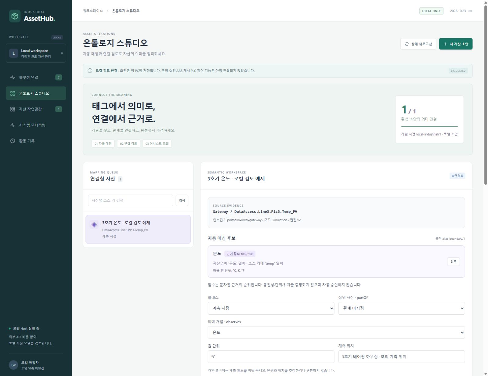
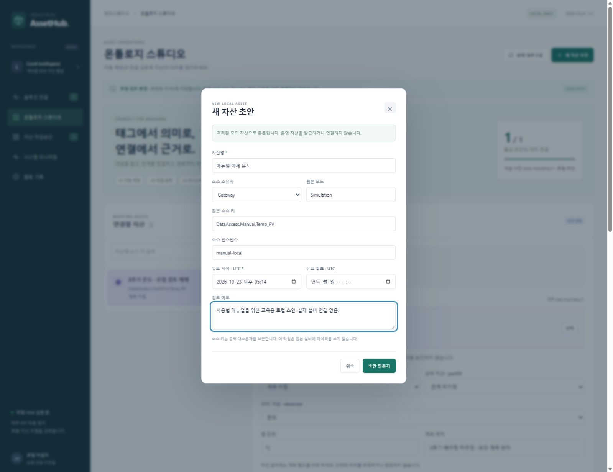
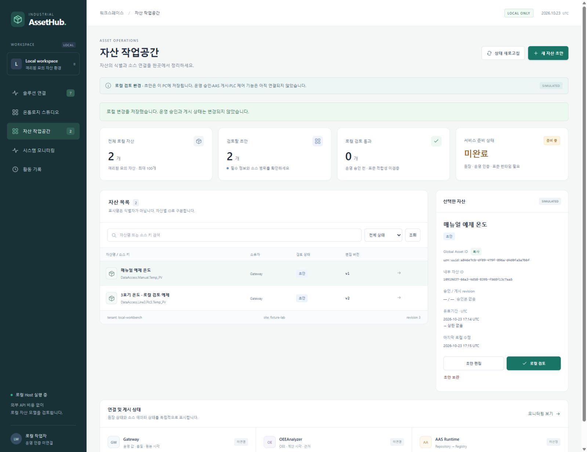
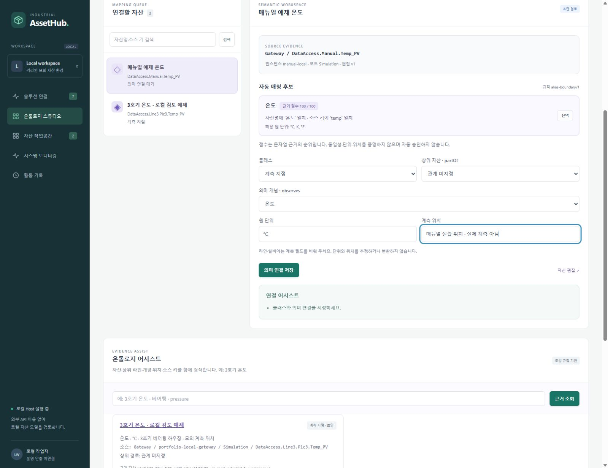
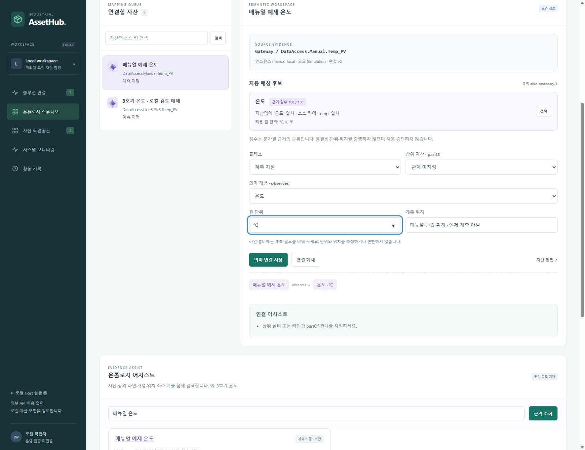
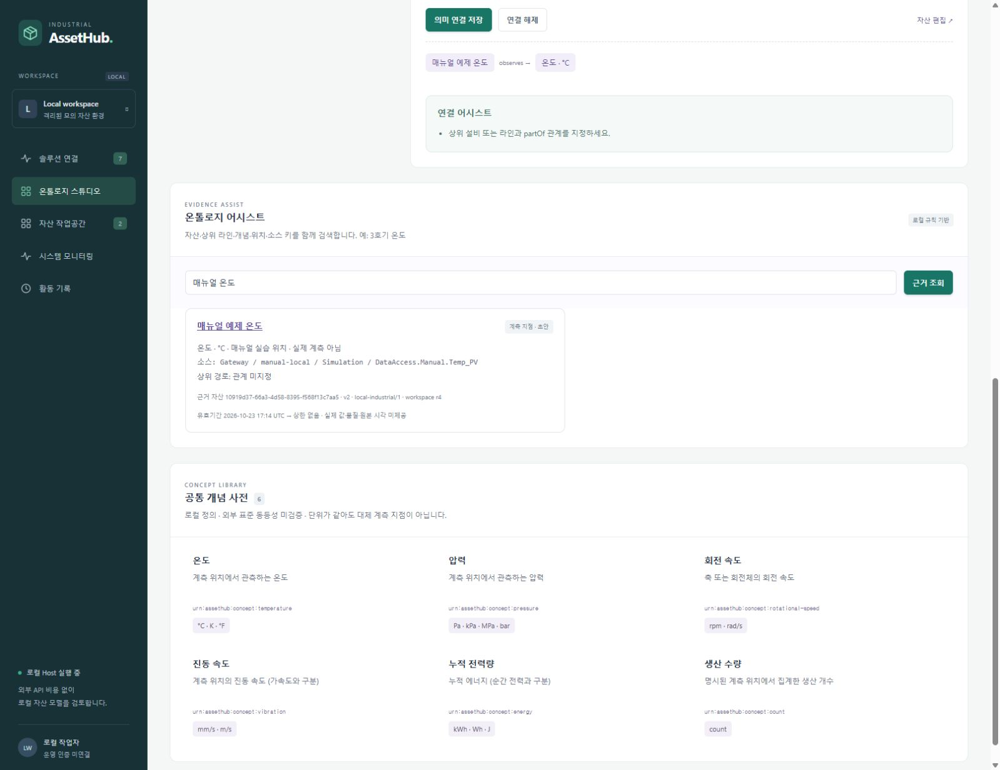
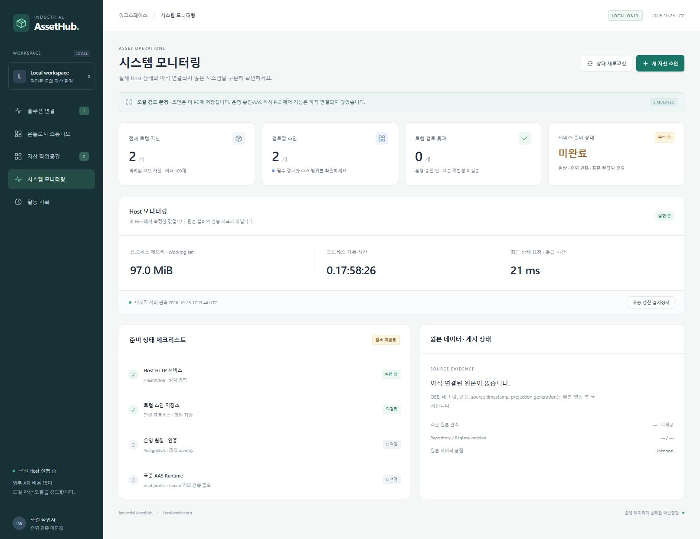
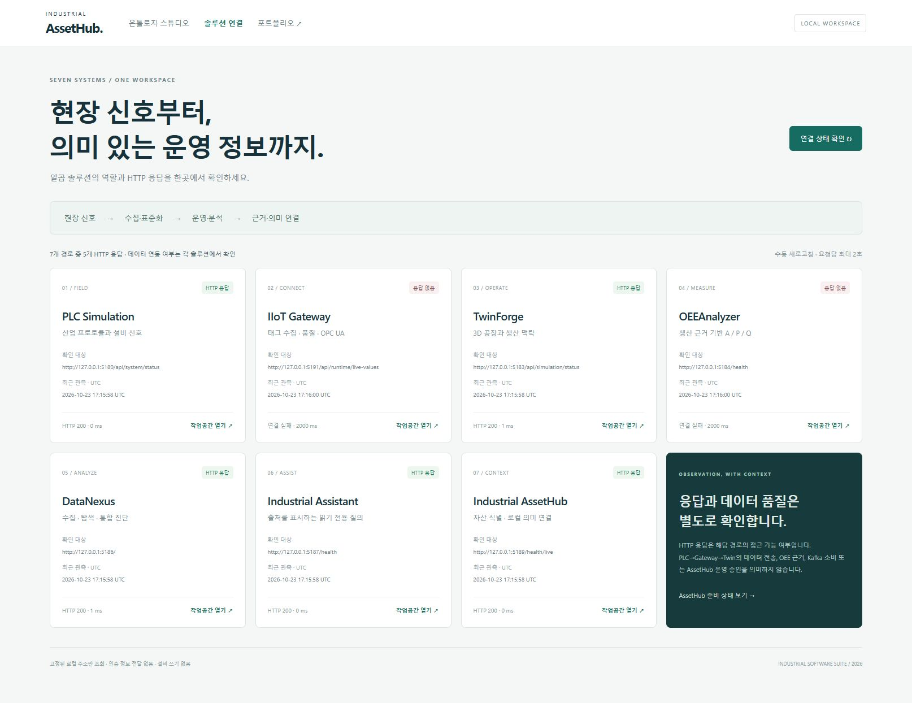

# Industrial AssetHub 사용 매뉴얼

접속: http://127.0.0.1:5189/workbench

local-workbench / fixture-lab의 모의 초안과 로컬 의미 연결. 운영 승인, AAS 게시, 실제 설비 제어는 제공하지 않습니다.

## 준비

- Workbench를 활성화한 로컬 Host가 실행 중이어야 합니다.
- 실습 예제는 원본 설비와 분리된 모의 초안으로 등록합니다.

실행 검증은 주요 동작의 관측 결과입니다. 문제 해결 분기 전체의 실행을 뜻하지 않습니다.

## 1. 온톨로지 스튜디오 확인

초안, 의미 연결, 개념 사전의 위치를 파악합니다.

검증 상태: 실행 확인

1. 온톨로지 스튜디오를 엽니다.
2. 연결할 자산 목록과 의미 연결 작업공간을 확인합니다.
3. 공통 개념 사전과 로컬 검토 환경 안내를 확인합니다.

기대 결과: 초안 수와 연결 진행률이 표시됩니다. 기존 예제가 있으면 첫 자산을 선택합니다.

관측 결과: 로컬 모의 자산 환경 및 운영 인증·게시·제어 미연결 배너 확인.

캡처 시각(UTC): 2026-10-23T17:15:02.511Z

문제 해결:

- 404이면 Workbench 활성화 프로필과 로컬 주소를 확인합니다.

## 2. 모의 자산 초안 입력

새 자산의 소스 정보를 선언합니다.

검증 상태: 실행 확인

1. 새 자산 초안을 누릅니다.
2. 자산명은 매뉴얼 예제 온도, 소스 소유자는 Gateway로 입력합니다.
3. 원본 모드 Simulation, 소스 인스턴스 manual-local, 원본 소스 키 DataAccess.Manual.Temp_PV를 입력합니다.
4. 유효 시작 UTC와 모의 예제라는 메모를 확인합니다.

기대 결과: 입력 창에 자산명, 소유자, 소스 범위가 표시됩니다. 입력만으로 원본 연결이 생성되지 않습니다.

관측 결과: 교육용 로컬 자산 필수 필드를 입력한 생성 화면.

캡처 시각(UTC): 2026-10-23T17:15:12.004Z

문제 해결:

- 등록을 취소하려면 취소나 닫기를 누릅니다.
- 시간은 UTC로 입력하고 종료는 시작보다 뒤로 지정합니다.

## 3. 초안 저장과 식별자 확인

초안을 저장하고 발급된 ID를 확인합니다.

검증 상태: 실행 확인

1. 입력값을 확인한 뒤 초안 만들기를 누릅니다.
2. 자산 작업공간의 새 행과 선택한 자산 상세를 확인합니다.
3. Global Asset ID와 편집 버전을 확인합니다.

기대 결과: 초안과 식별자를 로컬 파일에 저장합니다. 승인 및 게시 revision은 미제공으로 남습니다.

관측 결과: 매뉴얼 예제 온도 초안 생성 성공, 원본 소스와 저장된 자산 확인.

캡처 시각(UTC): 2026-10-23T17:15:12.288Z

문제 해결:

- 오래된 편집의 412 응답은 최신 초안을 다시 읽고 변경 내용을 비교합니다.
- 같은 저장 경로를 여러 Host가 동시에 열지 않습니다.

## 4. 개념 후보 선택

이름과 소스 키의 문자열 근거를 검토합니다.

검증 상태: 실행 확인

1. 온톨로지 스튜디오에서 매뉴얼 예제 온도를 선택합니다.
2. 자동 매칭 후보의 온도와 일치 근거를 읽습니다.
3. 선택을 눌러 개념을 채우고 원 단위와 계측 위치를 직접 입력합니다.

기대 결과: 선택한 개념이 의미 연결 폼에 반영됩니다. 점수는 문자열 순위이며 승인 확률이 아닙니다.

관측 결과: 온도 후보의 문자열 근거 확인 후 선택, 원 단위°C 및 교육용 위치 입력.

캡처 시각(UTC): 2026-10-23T17:15:29.887Z

문제 해결:

- 후보가 없으면 개념 사전에서 직접 고릅니다.
- 이름 일치만으로 서로 다른 계측 지점을 같은 자산으로 병합하지 않습니다.

## 5. 의미 연결 저장

계측 지점의 개념, 단위와 위치를 저장합니다.

검증 상태: 실행 확인

1. 클래스는 계측 지점, 의미 개념은 온도로 둡니다.
2. 원 단위 °C, 계측 위치는 실습 모의 계측 지점으로 입력합니다.
3. 의미 연결 저장을 누르고 저장된 observes 관계를 확인합니다.

기대 결과: 의미 연결과 편집 버전을 저장하며 기존 로컬 검토를 무효화합니다.

관측 결과: 저장된 관계에서 매뉴얼 예제 온도→온도°C, 위치와 소스 연결 확인.

캡처 시각(UTC): 2026-10-23T17:15:43.839Z

문제 해결:

- 라인과 설비에는 계측 필드를 비웁니다.
- 지원하지 않는 단위나 순환 partOf 관계는 서버가 거부합니다.

## 6. 의미 연결 근거 조회

키워드로 자산과 원본 소스 선언을 찾습니다.

검증 상태: 실행 확인

1. 온톨로지 어시스트에 매뉴얼 온도를 입력합니다.
2. 근거 조회를 누릅니다.
3. 자산, 개념, 위치, 소스 tuple과 편집 버전을 함께 확인합니다.

기대 결과: 로컬 초안 snapshot의 근거를 표시합니다. 실제 값, 품질과 원본 시각은 미제공입니다.

관측 결과: 매뉴얼 온도 검색1건: source owner/key/instance/version/validity 확인, 실제 값·품질·원본 시각 미제공 표시.

캡처 시각(UTC): 2026-10-23T17:16:26.424Z

문제 해결:

- 검색 결과가 없으면 키워드를 줄이고 먼저 의미 연결을 저장합니다.
- 이 어시스트는 규칙 기반 검색이며 외부 AI를 호출하지 않습니다.

## 7. Host 상태와 준비 상태 확인

실행 중인 Host와 운영 준비 상태를 구분합니다.

검증 상태: 실행 확인

1. 시스템 모니터링을 엽니다.
2. 상태 새로고침을 누릅니다.
3. 메모리, 가동 시간과 관측 시각을 확인하고 준비 상태 체크리스트를 읽습니다.

기대 결과: Host 실행과 서비스 미준비를 별도로 표시합니다. 현재 운영 원장, 인증과 표준 runtime은 준비 중입니다.

관측 결과: 시스템 모니터링의 Gateway/OEE/AAS 상태와 미연결 정보 확인.

캡처 시각(UTC): 2026-10-23T17:15:44.385Z

문제 해결:

- 상태 요청 실패 시 최근 성공값을 현재 관측으로 해석하지 않습니다.

## 8. 일곱 솔루션 연결 상태 확인

로컬 솔루션으로 이동하고 HTTP 응답을 확인합니다.

검증 상태: 실행 확인

1. 솔루션 연결을 엽니다.
2. 연결 상태 확인을 누릅니다.
3. HTTP 응답 코드, 지연과 UTC 관측 시각을 읽고 작업공간 열기로 이동합니다.

기대 결과: 고정된 loopback 경로를 최대 2초씩 조회합니다. HTTP 응답만으로 데이터 전송이나 운영 승인을 입증하지 않습니다.

관측 결과: 연결 상태 확인 완료:7개 중5개 HTTP응답, Gateway/OEE백엔드 응답없음.

캡처 시각(UTC): 2026-10-23T17:16:03.983Z

문제 해결:

- Gateway와 OEE API가 중지된 현재 환경에서는 응답 없음이 정상 진단입니다.
- 각 UI가 열리는지와 해당 backend의 수집 상태를 별도로 확인합니다.

## 구현 근거

- `Industrial.AssetHub/README.md`
- `Industrial.AssetHub/src/AssetHub.Host/Pages/Workbench/Index.cshtml`
- `Industrial.AssetHub/src/AssetHub.Host/Pages/Workbench/_Ontology.cshtml`
- `Industrial.AssetHub/src/AssetHub.Host/Workbench/SuiteMonitor.cs`
