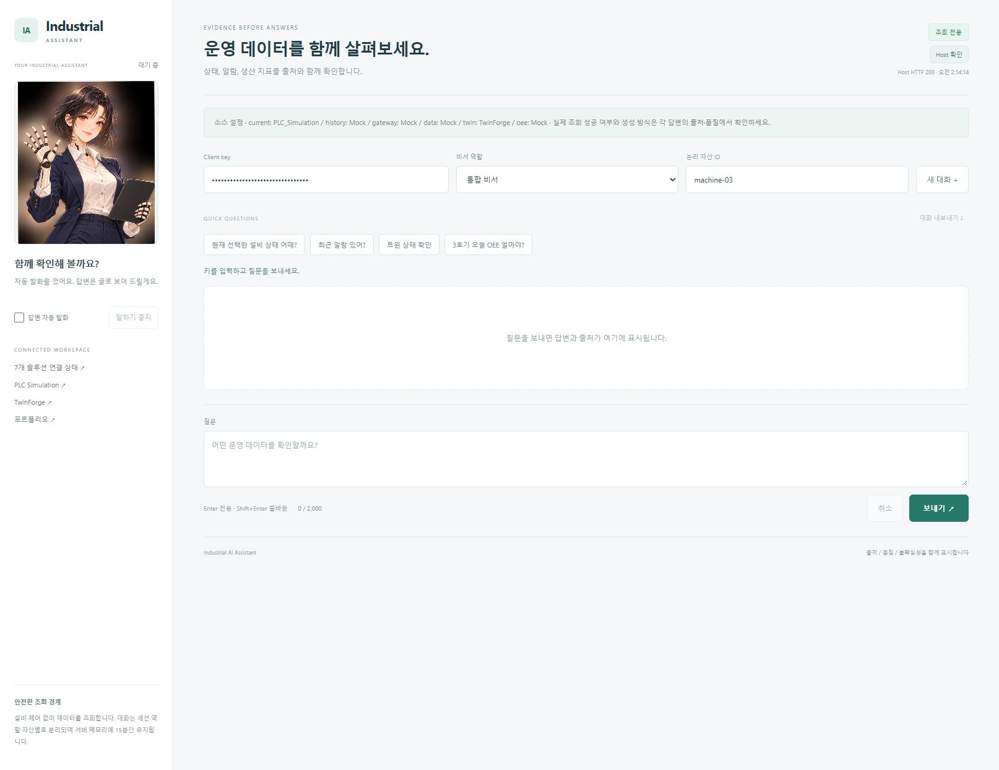
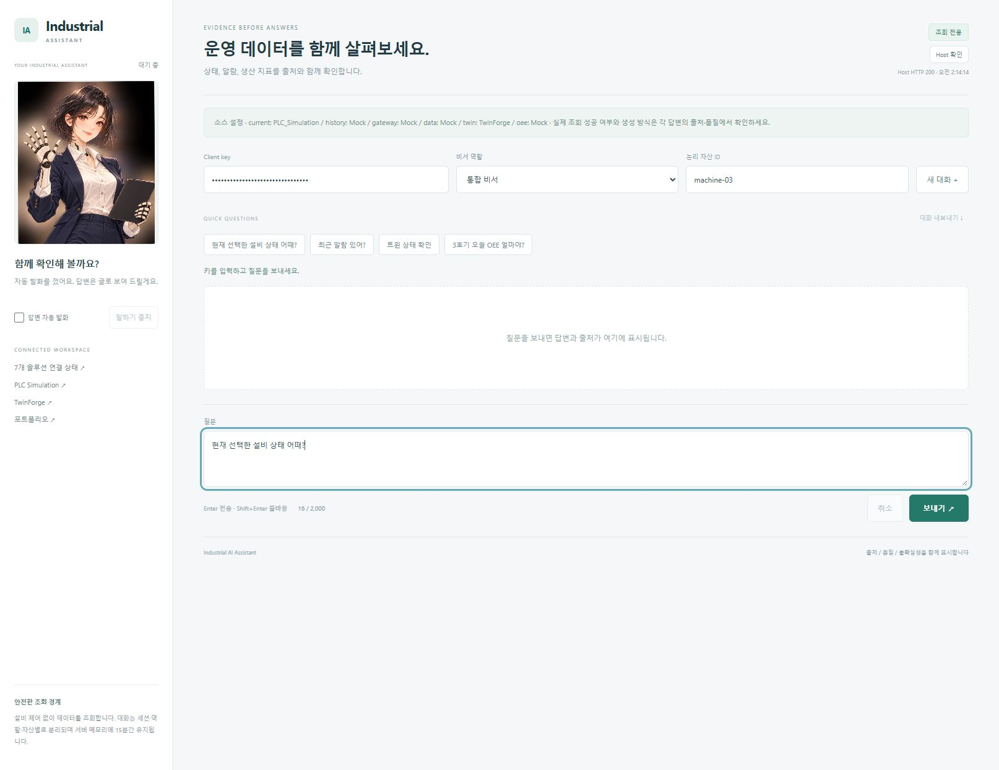
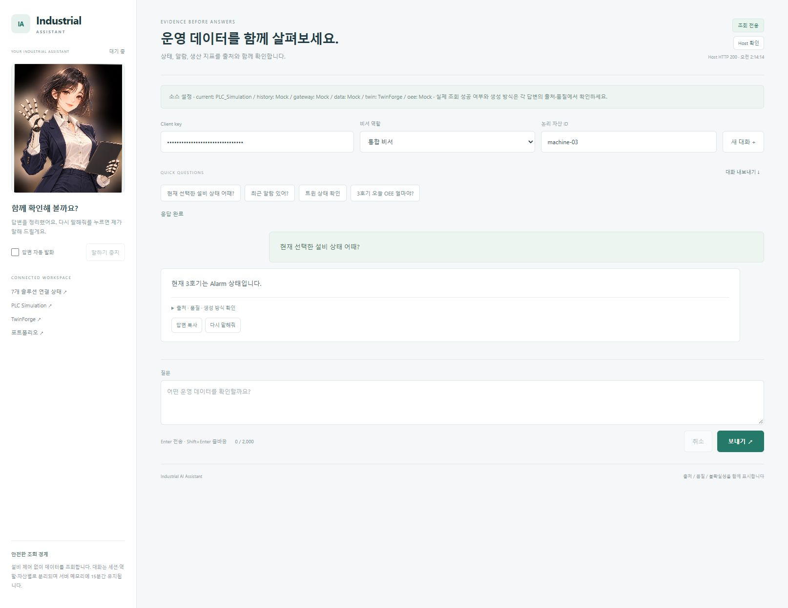
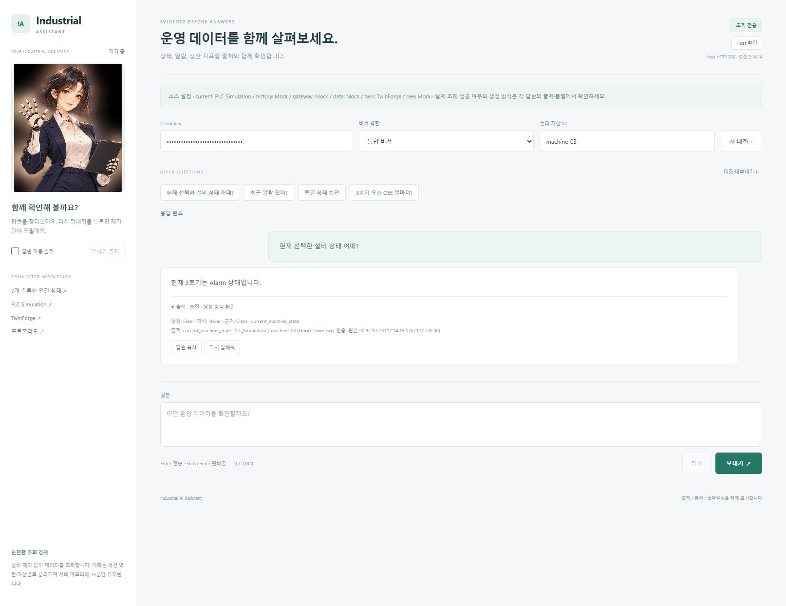
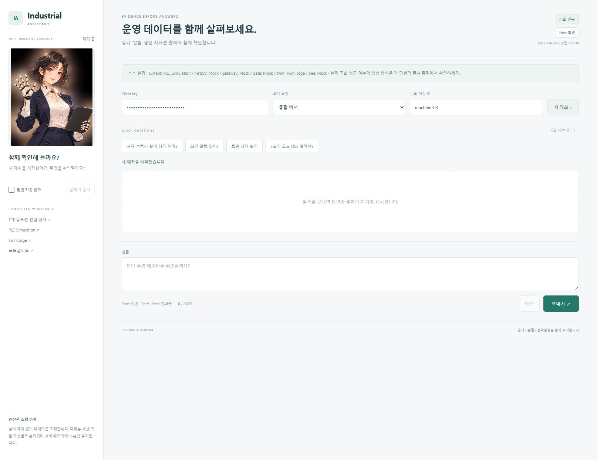

# Industrial AI Assistant 사용 매뉴얼

접속: http://127.0.0.1:5187/chat-test/

PLC HTTP 조회와 결정적 Fake 답변을 사용하는 로컬 읽기 전용 실습. History, Gateway, DataCatalog, OEE는 Mock 구성이다.

## 준비

- Assistant Host와 Python 서비스가 실행 중이어야 합니다.
- 실행 터미널의 일회성 Client key를 준비합니다. 매뉴얼이나 내보내기에 키를 적지 않습니다.
- PLC 상태 실습은 PLC Simulation :5180 실행과 machine-03의 매핑이 필요합니다.

실행 검증은 주요 동작의 관측 결과입니다. 문제 해결 분기 전체의 실행을 뜻하지 않습니다.

## 1. 접속과 조회 범위 확인

선택한 역할과 자산, 실제 소스 구성을 확인합니다.

검증 상태: 실행 확인

1. 채팅 주소를 열고 Client key에 실행 터미널의 키를 입력합니다.
2. 비서 역할을 통합 비서, 논리 자산 ID를 machine-03으로 둡니다.
3. 소스 설정에서 current: PLC_Simulation, twin: TwinForge를 확인합니다.
4. Host 확인을 누르고 HTTP 응답을 확인합니다.

기대 결과: Host 응답 시각과 HTTP 코드가 표시됩니다. 소스 설정은 개별 조회 성공과 별개입니다.

관측 결과: Client key 마스킹 상태. Host 확인과 PLC_Simulation/TwinForge 실제 소스 설정, 나머지 Mock 확인.

캡처 시각(UTC): 2026-10-23T17:14:15.190Z

문제 해결:

- 401이면 현재 실행의 Client key를 다시 확인합니다.
- Host 응답이 없으면 로컬 서비스를 실행한 뒤 페이지를 다시 엽니다.

## 2. 예시 질문과 입력

질문을 선택하고 전송 전에 내용을 확인합니다.

검증 상태: 실행 확인

1. 현재 선택한 설비 상태 어때? 예시 버튼을 누릅니다.
2. 입력창의 질문과 글자 수를 확인합니다.
3. 줄바꿈은 Shift+Enter, 전송은 Enter 또는 보내기를 사용합니다.

기대 결과: 예시 질문이 입력되고 글자 수가 함께 갱신됩니다. 최대 입력은 2,000자입니다.

관측 결과: 예시 질문으로 현재 선택한 설비 상태 질문을 입력; 2000자 제한 안내.

캡처 시각(UTC): 2026-10-23T17:14:15.556Z

문제 해결:

- 한글 조합 중 Enter는 조합을 먼저 마칩니다.
- 설비 제어 요청을 이 실습의 조회 기능으로 실행하지 않습니다.

## 3. PLC 상태 조회

선택한 설비의 현재 상태를 실제 PLC HTTP 소스에서 읽습니다.

검증 상태: 실행 확인

1. PLC Simulation이 실행 중인지 확인합니다.
2. 현재 상태 질문을 보내기를 눌러 전송합니다.
3. 답변 대기 중에는 역할, 자산, 키 변경을 기다립니다.
4. 응답 완료와 답변 내용을 확인합니다.

기대 결과: 상태 답변 또는 구체적인 조회 오류가 표시됩니다. 이 판의 답변 생성 방식은 Fake입니다.

관측 결과: 질문 응답 성공. 실제 PLC 스냅샷과 별도 생성 방식 구분.

캡처 시각(UTC): 2026-10-23T17:14:28.195Z

문제 해결:

- SOURCE_UNAVAILABLE이면 PLC 서비스와 주소를 확인합니다.
- ASSET_NOT_MAPPED이면 선택 자산과 선언된 소스 매핑을 확인합니다.

## 4. 출처와 품질 확인

답변의 근거와 생성 방식을 확인합니다.

검증 상태: 실행 확인

1. 답변 아래 출처 · 품질 · 생성 방식 확인을 펼칩니다.
2. 생성 방식, 인용 여부, 소스 소유자와 원본 시각을 읽습니다.
3. Good 품질과 최신 시각을 함께 확인합니다. Unknown이나 오류는 확인되지 않은 상태로 해석합니다.

기대 결과: PLC_Simulation 출처, 원본 시각, 품질과 Fake 생성 표시를 확인할 수 있습니다.

관측 결과: 근거 펼침: PLC_Simulation, Good, 원본 시각과 생성 방식Fake 확인.

캡처 시각(UTC): 2026-10-23T17:14:42.113Z

문제 해결:

- 오래된 Good 값은 현재 값으로 단정하지 않습니다.
- 근거 None 또는 Unavailable이면 답변을 현재 설비 사실로 사용하지 않습니다.

## 5. 답변과 근거 복사

근거를 포함한 답변을 복사합니다.

검증 상태: 실행 확인

1. 확인한 답변의 답변 복사 버튼을 누릅니다.
2. 버튼이 복사됨으로 바뀌는지 확인합니다.
3. 필요한 문서에 붙여 넣고 소스와 관측 시각을 함께 보존합니다.

기대 결과: 답변 본문과 근거 메타데이터가 함께 복사됩니다. Client key는 포함하지 않습니다.

관측 결과: 복사 완료 표시, 클립보드 PLC_Simulation 근거 포함 확인.

캡처 시각(UTC): 2026-10-23T17:14:42.493Z

문제 해결:

- 복사 실패가 표시되면 브라우저의 클립보드 접근 상태를 확인합니다.

## 6. 대화 기록 내보내기

현재 대화를 Markdown 파일로 저장합니다.

검증 상태: 실행 확인

1. 질문과 답변이 있는 대화에서 대화 내보내기를 누릅니다.
2. 다운로드된 industrial-assistant-날짜.md 파일을 엽니다.
3. 질문, 답변, UTC 시각과 근거를 확인합니다.

기대 결과: 최대 100개 메시지의 Markdown 기록을 저장합니다. 키와 내부 세션 인증 정보는 제외합니다.

관측 결과: Markdown 다운로드 파일 확인, PLC 출처 포함 및 client key 미포함 검증.

캡처 시각(UTC): 2026-10-23T17:14:53.455Z

문제 해결:

- 빈 대화에서는 내보내기 버튼이 비활성입니다.
- 다운로드가 차단되면 이 로컬 페이지의 다운로드 알림을 확인합니다.

## 7. 새 대화 시작

이전 대화 맥락을 끊고 새 조회를 시작합니다.

검증 상태: 실행 확인

1. 보관할 대화가 있으면 먼저 내보냅니다.
2. 새 대화 +를 누릅니다.
3. 대화 목록이 비고 내보내기 버튼이 비활성인지 확인합니다.

기대 결과: 새 대화를 시작했습니다가 표시됩니다. 역할이나 자산을 바꿀 때도 새 대화를 시작합니다.

관측 결과: 새 대화 실행 후 대화 목록 비움, 내보내기 비활성 확인.

캡처 시각(UTC): 2026-10-23T17:14:53.821Z

문제 해결:

- 서버 대화는 세션, 역할, 자산별로 구분하며 메모리에서 15분 유지합니다.
- 이 기능은 영구 대화 기록 삭제나 감사 원장 삭제 기능이 아닙니다.

## 구현 근거

- `industrial-ai-assistant/src/server/IndustrialAIAssistant.Host/ChatTest/index.html`
- `industrial-ai-assistant/src/server/IndustrialAIAssistant.Host/ChatTest/chat.js`
- `industrial-ai-assistant/scripts/chat-test-host.py`
