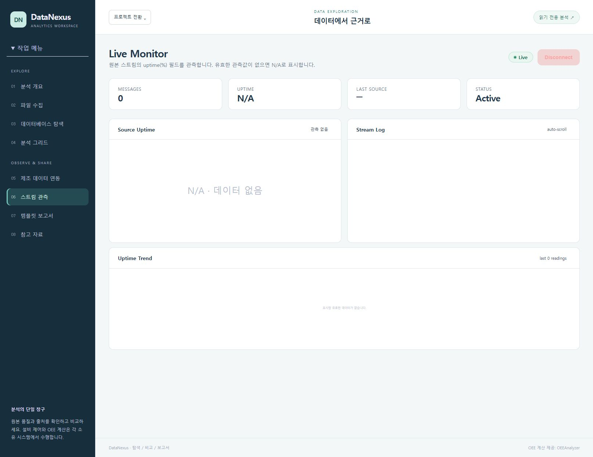
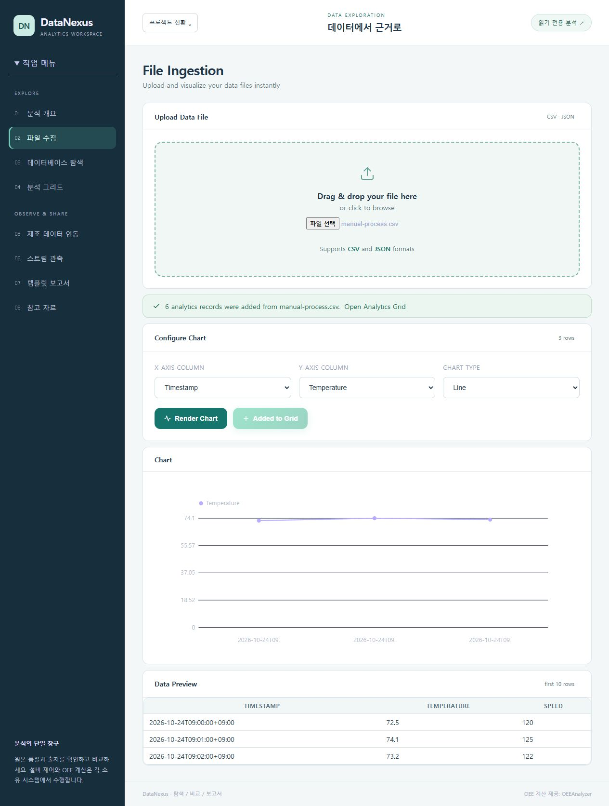
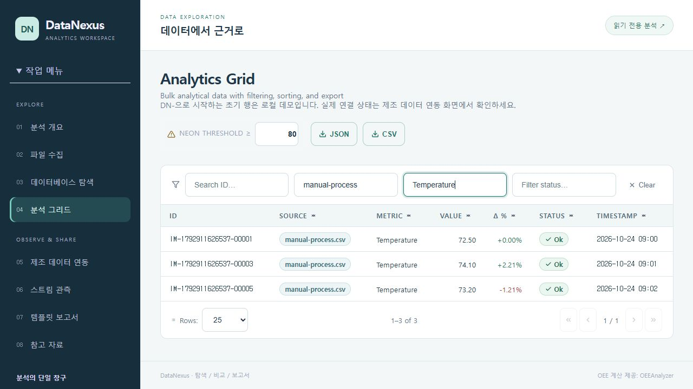
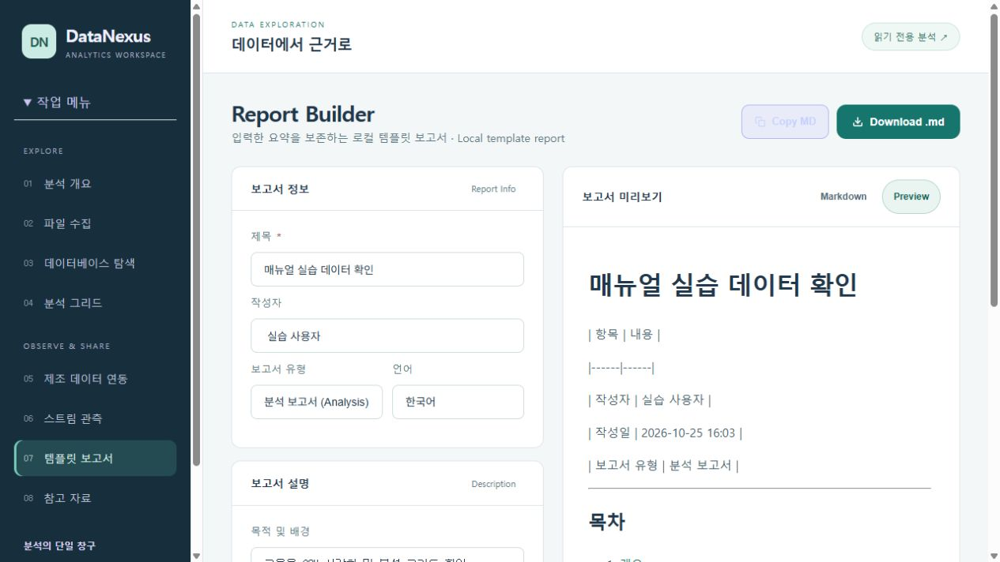
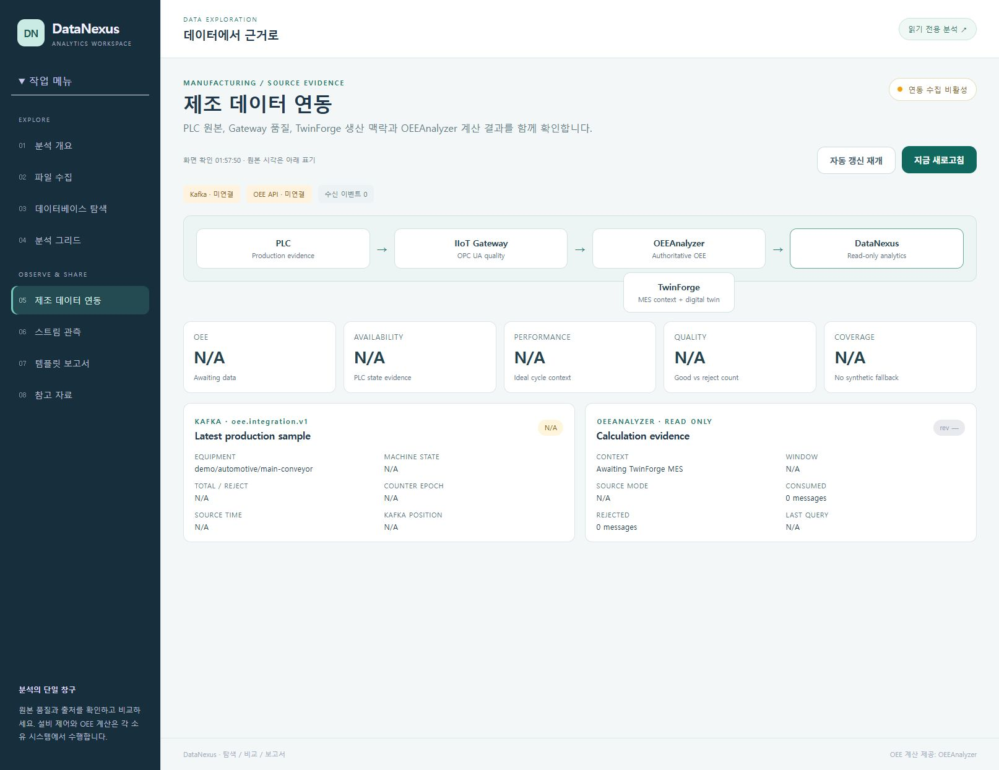

# DataNexus Analytics 사용 매뉴얼

접속: http://127.0.0.1:5186/

로컬 데이터 파일을 차트와 분석 그리드로 살펴보고 입력 요약을 템플릿 보고서로 작성합니다. 제조 연동 화면은 원본 품질·시각과 의존성 상태를 읽기 전용으로 관측합니다. 현재 Kafka/OEE 경로는 미연결 또는 비활성 상태이며 실시간 생산 지표가 준비된 것으로 표시하지 않습니다.

## 준비

- 로컬 DataNexus http://127.0.0.1:5186/ 가 실행 중이어야 합니다.
- 현재 실습은 Streaming:EnableDemoStream=false, IndustrialIntegration:Enabled=false로 실행합니다. 로컬 Hub 연결과 제조 이벤트 수신은 서로 다른 상태입니다.
- 파일 실습은 아래 교육용 가상 CSV만 사용합니다. 업로드 기본 제한은 10MB이며 CSV/JSON 형식을 지원합니다.
- 분석 그리드의 DN- 접두 초기 행은 로컬 데모입니다. 업로드로 추가한 IM- 행 및 실제 제조 연동 데이터와 구분합니다.
- 보고서 생성은 입력 요약을 보존하는 로컬 템플릿 처리입니다. 외부 생성형 AI 호출이나 생산 데이터 자동 검증을 수행하지 않습니다.

실행 검증은 주요 동작의 관측 결과입니다. 문제 해결 분기 전체의 실행을 뜻하지 않습니다.

실습 자료: [교육용 CSV](../samples/manual-process.csv). 파일의 값은 실제 생산 계측값이 아닙니다.

## 1. 분석 개요에서 스트림 연결 상태 확인

화면 연결 성공과 실제 데이터 수신 여부를 분리해 읽습니다.

검증 상태: 실행 확인

1. http://127.0.0.1:5186/ 에 접속하거나 왼쪽 '분석 개요'를 누릅니다.
2. '스트림 대기' 배지와 Stream Messages, Connection Status, Latest Source 카드를 확인합니다.
3. '스트림 연결'을 누릅니다. 연결되면 '스트림 연결됨'과 '실제 데이터 수신을 기다립니다.' 안내를 확인합니다.
4. 현재 데모 스트림과 제조 수집이 비활성인 실습에서는 수신 0건과 Latest Source '—'가 유지될 수 있습니다. 이를 정상 생산 수집으로 기록하지 않습니다.
5. 원복: 'Disconnect'를 눌러 연결을 닫습니다. 서버나 다른 앱의 수집을 중지하는 동작은 아닙니다.

기대 결과: 성공하면 로컬 스트림 Hub 연결 상태만 Active로 바뀝니다. 수신 데이터가 있어야 이벤트와 최근 원본이 채워집니다. 화면은 최근 500개 이벤트만 보관합니다.

관측 결과: SignalR 연결과 수신 이벤트 0을 구분, uptime 원본 관측 전 N/A 표시

캡처 시각(UTC): 2026-10-23T17:03:53.337Z

문제 해결:

- 연결 실패 안내가 보이면 :5186 서버가 실행 중인지 확인하고 다시 시도합니다.
- 연결됨인데 수신 0건이면 제조 데이터 연동에서 Kafka/OEE 상태를 확인합니다. 연결 배지만으로 수집 완료로 판단하지 않습니다.

## 2. 교육용 CSV 업로드·차트 작성·그리드로 추가

파일 열기부터 숫자 지표 차트와 분석 레코드 추가까지 진행합니다.

검증 상태: 실행 확인

1. 왼쪽 파일 수집 또는 /file-ingestion을 엽니다. 함께 제공한 samples/manual-process.csv를 UTF-8 파일로 준비합니다.
2. 'Drag & drop your file here / or click to browse' 영역을 눌러 파일을 선택합니다. 업로드 후 Configure Chart의 3 rows와 컬럼 목록을 확인합니다.
3. 'X-Axis Column'=Timestamp, 'Y-Axis Column'=Temperature, 'Chart Type'=Line으로 선택하고 'Render Chart'를 누릅니다.
4. 교육용 캐시에 추가할 때만 'Add to Analytics Grid'를 누릅니다. 3행 × 숫자 지표 2개이므로 6개 분석 레코드 추가 안내와 'Added to Grid'를 확인합니다.
5. 'Open Analytics Grid'로 이동합니다. 화면만 원복하려면 파일 수집으로 돌아가 새 파일을 선택하거나 페이지를 다시 엽니다. 이미 추가한 레코드는 캐시에 남으며 UI에서 개별 삭제하는 기능은 없습니다.

기대 결과: Timestamp에 따른 Temperature 3개 점이 차트로 표시됩니다. 그리드 추가 시 Source는 파일명, ID는 IM- 접두이며 Temperature·Speed 총 6개 레코드가 생성됩니다. 이 수치는 교육용 가상값입니다.

관측 결과: manual-process.csv 3행을 업로드하고 Timestamp/Temperature/Line으로 차트를 렌더링한 뒤 분석 그리드에 추가했습니다. 화면의 '6 analytics records were added from manual-process.csv' 성공 배너를 확인했습니다.

캡처 시각(UTC): 2026-10-23T17:04:44.289Z

캡처 안내: 2026-10-25 대비 보정 후 실제 재촬영. 교육용 CSV 실습이며 실제 생산 데이터가 아닙니다.

문제 해결:

- 빈 파일·지원하지 않는 확장자·기본 10MB 초과 파일은 오류가 표시됩니다. 헤더가 있고 숫자 값이 들어 있는 CSV를 사용합니다.
- 'No numeric metric columns were found'이면 시간·식별자 컬럼 외에 숫자 지표가 있는지 확인합니다. 같은 파일의 추가 버튼이 Added to Grid로 바뀌면 중복해서 누르지 않습니다.

## 3. 분석 그리드 필터·강조 기준·내보내기

업로드 지표만 선택해 비교하고 현재 필터 결과를 파일로 보관합니다.

검증 상태: 실행 확인

1. 분석 그리드에서 Source에 manual-process, Metric에 Temperature를 입력합니다.
2. Neon threshold ≥ 값 80을 확인합니다. 이번 캡처는 기준 80이며 강조된 행이 없습니다.
3. Temperature 3행의 72.50, 74.10, 73.20과 Source·Status·Timestamp를 함께 비교합니다.
4. CSV 또는 JSON으로 현재 필터 결과 전체를 내려받을 수 있습니다.
5. Clear로 필터를 초기화하고 강조 기준을 기본값 80으로 유지합니다.

기대 결과: Temperature 3행과 Source·값·Status·Timestamp를 함께 확인합니다.

관측 결과: Search source=manual-process, Search metric=Temperature 필터로 1–3 of 3을 확인했습니다. 값은 72.50, 74.10, 73.20이며 Source·Status·Timestamp·CSV/JSON 버튼이 보입니다.

캡처 시각(UTC): 2026-10-23T17:17:53.470Z

캡처 안내: 2026-10-25 실제 재촬영. 강조 기준 80에서 파일·지표 필터 3행을 확인했으며 강조된 행은 없습니다.

문제 해결:

- 검색 결과가 없으면 Clear 후 Source 열을 확인합니다. 업로드만 하고 Add to Analytics Grid를 누르지 않았다면 IM- 행은 생성되지 않습니다.
- 다운로드가 보이지 않으면 브라우저 다운로드 목록을 확인합니다. CSV/JSON 저장은 분석 그리드의 로컬 파일 내보내기입니다.

이전 자료 안내: 원문의 기준 74와 74.1 강조는 이전 절차와 연습 예시입니다. 이번 기준 80 캡처의 실행 근거로 사용하지 않습니다.

## 4. 로컬 템플릿 보고서 생성과 Markdown 저장

관측 결과와 미연결 제한을 남기는 재현 가능한 보고서를 만듭니다.

검증 상태: 실행 확인

1. 왼쪽 '템플릿 보고서' 또는 /report을 엽니다. Report Builder에서 제목을 '교육용 공정 데이터 확인', 작성자를 실습 담당자로 입력합니다.
2. '보고서 유형'은 기본 '분석 보고서 (Analysis)', '언어'는 '한국어'로 둡니다. '목적 및 배경'에 '교육용 CSV 시각화 및 연동 상태 확인'을 입력합니다.
3. '데이터 내용 / 분석 결과'에 '교육용 가상 CSV 3행. Temperature 72.5/74.1/73.2, Speed 120/125/122. Kafka/OEE 미연결로 실제 생산 OEE는 확인하지 못함.'을 입력합니다.
4. '보고서 생성'을 누르고 'Markdown'과 'Preview' 탭을 전환하여 입력한 요약이 보존되는지 확인합니다.
5. 'Copy MD'로 복사하거나 'Download .md'로 저장합니다. 원복: 입력을 바꾸어 다시 생성하거나 페이지를 다시 열면 됩니다. 다운로드한 파일은 사용자가 별도로 보관합니다.

기대 결과: 입력한 제목·작성자·목적·요약이 로컬 보고서 템플릿에 채워집니다. 이 기능은 외부 AI 분석이나 입력 수치의 진위 검증을 수행하지 않습니다.

관측 결과: 제목·작성자·목적·교육용 데이터 요약을 입력해 로컬 템플릿 보고서를 생성하고 Preview를 확인했습니다. Copy MD 후 브라우저 세션 클립보드의 524자 보고서 제목과 온도값을 확인했고, Download .md의 실제 파일을 저장했습니다. 복사한 문자열과 다운로드 파일의 내용이 일치합니다.

캡처 시각(UTC): 2026-10-23T17:08:13.380Z

캡처 안내: 2026-10-25 대비 보정 후 실제 재촬영. 생성·Preview·Copy MD·Download .md 실행을 확인했습니다.

검증 범위: 2026-10-25 대비 보정 후 실제 재촬영. 생성·Preview·Copy MD·Download .md 실행을 확인했습니다.

문제 해결:

- 제목이 비어 있으면 보고서 생성이 비활성입니다.
- Copy MD가 브라우저 권한 때문에 실패하면 Download .md를 사용합니다. 보고서에 없는 생산 지표를 자동으로 보완하거나 추정한 것으로 해석하지 않습니다.

## 5. 제조 연동 의존성 확인과 화면 갱신 제어

원본 관측 상태를 확인하고 읽는 동안 자동 갱신을 잠시 멈춥니다.

검증 상태: 실행 확인

1. 왼쪽 '제조 데이터 연동' 또는 /industrial-integration을 엽니다.
2. 오른쪽 상태 배지, 'Kafka · 미연결', 'OEE API · 미연결', 수신 이벤트 수를 확인합니다. 현재 실습에서는 '연동 수집 비활성' 또는 의존성 대기 상태가 예상됩니다.
3. OEE·Availability·Performance·Quality·Coverage가 N/A이면 계산 근거가 없는 상태로 기록합니다. 0%로 바꾸어 해석하지 않습니다.
4. '자동 갱신 일시정지'를 누르고 버튼이 '자동 갱신 재개'로 바뀌는지 확인합니다. 필요하면 '지금 새로고침'으로 현재 저장된 스냅샷을 다시 표시합니다.
5. 원복: '자동 갱신 재개'를 누릅니다. 이 버튼은 화면의 1초 갱신만 제어하며 Kafka/OEE 서버를 시작·중지하거나 강제 재수집하지 않습니다.

기대 결과: 의존성별 연결과 원본 시각·품질·계산 근거를 구분해 볼 수 있습니다. 비활성/미연결 환경에서는 데이터와 OEE가 없다는 상태가 그대로 유지됩니다.

관측 결과: 수집 비활성, Kafka/OEE 미연결, 자동 갱신 일시정지와 수동 새로고침 확인

캡처 시각(UTC): 2026-10-23T16:57:50.626Z

문제 해결:

- '화면 확인' 시각과 Source time은 서로 다릅니다. 새로고침한 화면 시각을 원본 데이터 생성 시각으로 사용하지 않습니다.
- 진단 오류나 N/A가 지속되면 Kafka 수신 경로와 OEE API를 담당자가 복구해야 합니다. '지금 새로고침'은 미연결 의존성을 연결하는 버튼이 아닙니다.

## 구현 근거

- `DataNexus-Analytics/src/DataNexus.Web/Components/Pages/Dashboard.razor`
- `DataNexus-Analytics/src/DataNexus.Web/Components/Pages/FileIngestion.razor`
- `DataNexus-Analytics/src/DataNexus.Web/Components/Pages/AnalyticsGrid.razor`
- `DataNexus-Analytics/src/DataNexus.Web/Components/Pages/Report.razor`
- `DataNexus-Analytics/src/DataNexus.Web/Components/Pages/IndustrialIntegration.razor`
- `DataNexus-Analytics/src/DataNexus.Infrastructure/Analytics/AnalyticsDataService.cs`
- `DataNexus-Analytics/src/DataNexus.Infrastructure/Reports/ReportService.cs`
