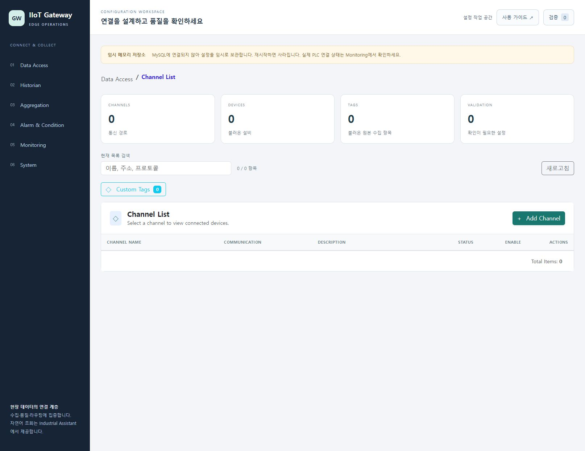
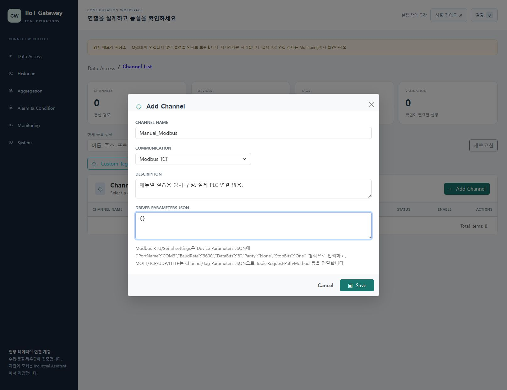
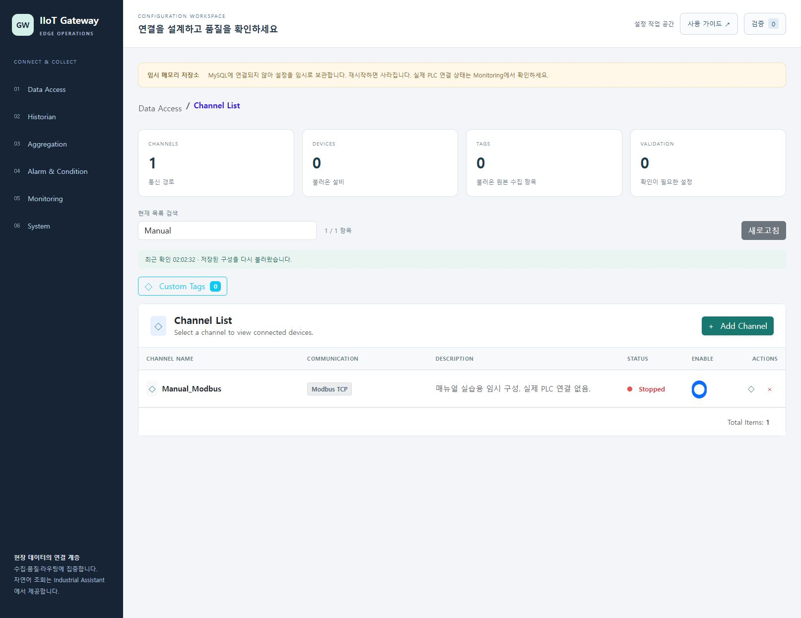
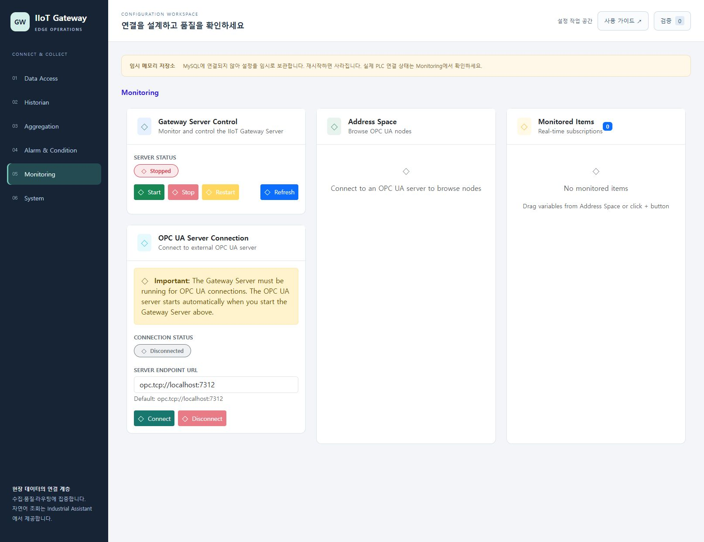

# IIoT Gateway 사용 매뉴얼

접속: http://127.0.0.1:5181/

ConfigUI에서 수집 구성을 확인하고 채널 입력 양식을 검토하며 목록 검색·새로고침과 Gateway/OPC UA 상태를 점검합니다. 현재 실습은 UI의 임시 메모리 저장소를 사용합니다. backend http://127.0.0.1:5191 과 실제 OPC UA 수집은 사용 불가 상태이므로 생산 수집 정상 상태로 간주하지 않습니다.

## 준비

- 로컬 ConfigUI http://127.0.0.1:5181/ 가 실행 중이어야 합니다.
- 현재 화면의 '임시 메모리 저장소'는 MySQL 미연결 상태입니다. 여기서 저장한 설정은 재시작 시 사라질 수 있습니다.
- UI에 접근할 수 있다는 사실과 Gateway backend·OPC UA 연결 성공은 별개입니다. 현재 backend :5191은 사용 불가입니다.
- 아래 채널 실습은 격리된 임시 메모리 UI에 교육용 채널 하나를 저장합니다. 실제 장치 주소, 운영 설정 또는 인증서를 변경하지 않습니다.

실행 검증은 주요 동작의 관측 결과입니다. 문제 해결 분기 전체의 실행을 뜻하지 않습니다.

## 1. Data Access 구성 현황과 저장소 상태 확인

채널·설비·태그 카운트가 무엇을 의미하는지 구분하고 임시 저장 여부를 확인합니다.

검증 상태: 실행 확인

1. http://127.0.0.1:5181/ 에 접속한 뒤 왼쪽 'Data Access'를 누릅니다.
2. 화면 위 '임시 메모리 저장소' 안내를 읽습니다. 이 안내가 보이는 실습에서는 MySQL 영구 저장이 이루어지지 않습니다.
3. CHANNELS, DEVICES, TAGS, VALIDATION 카드를 확인합니다. DEVICES와 TAGS는 현재 불러온 데이터 범위의 카운트입니다.
4. 아래 목록에서 Channel Name, Communication, Description, Status, Enable을 읽습니다. 등록 또는 Enable만으로 수집 성공을 판정하지 않습니다.
5. 원복: 이 조회는 설정을 변경하지 않습니다. 다른 메뉴에서 돌아올 때는 'Data Access'를 다시 누릅니다.

기대 결과: 현재 저장소에서 읽은 구성과 검증 항목 수가 표시됩니다. 빈 목록은 구성 없음 상태이며 실제 PLC가 연결되었다는 뜻이 아닙니다.

관측 결과: Data Access 초기 구성 화면과 임시 메모리 저장 안내 확인

캡처 시각(UTC): 2026-10-23T17:01:33.422Z

문제 해결:

- 화면 연결 오류가 나오면 ConfigUI 서버와 :5181 주소를 확인합니다.
- 임시 메모리 안내가 보이면 운영 구성 저장에 사용하지 않고 MySQL 연결을 담당자가 별도로 복구해야 합니다.

## 2. 교육용 Modbus 채널 저장과 목록 확인

격리된 임시 메모리 저장소에 채널을 등록하고 등록과 실제 연결의 차이를 확인합니다.

검증 상태: 실행 확인

1. 'Data Access'의 Channel List에서 'Add Channel'을 누릅니다.
2. 'Channel Name'에 기존 이름과 겹치지 않는 'Manual_Modbus'를 입력합니다. 중복 이름은 OPC UA NodeID 충돌 안내가 표시됩니다.
3. 'Communication'은 기본값 'Modbus TCP'로 유지하고 'Description'에 '매뉴얼 실습용 임시 구성. 실제 PLC 연결 없음.'을 입력합니다.
4. 'Driver Parameters JSON'에 '{}'를 입력하고 'Save'를 누릅니다. 이 빈 객체는 등록 실습용이며 실제 드라이버 연결에 충분한 설정이 아닙니다.
5. Channel List에 Manual_Modbus가 추가되고 CHANNELS 및 전체 항목 수가 1 증가했는지 확인합니다. 빈 저장소에서 시작한 캡처는 1 / 1 항목입니다. 원복: 실습 종료 시 이 교육용 채널의 삭제 아이콘을 눌러 확인창에서 삭제를 확정합니다. 저장 전 취소하려면 Cancel을 사용합니다.

기대 결과: 교육용 채널 한 개가 현재 임시 메모리 목록에 저장됩니다. 새 채널 기본 상태는 Modbus TCP, Enabled=true, Status=Stopped입니다. 등록만으로 실제 PLC/OPC UA가 연결되지는 않습니다.

관측 결과: Add Channel 입력값과 Modbus TCP 선택, 실습용 임시 구성 안내

캡처 시각(UTC): 2026-10-23T17:02:15.980Z

문제 해결:

- 중복 오류가 보이면 다른 고유 이름을 입력합니다. 기존 채널 이름을 바꾸어 해결하지 않습니다.
- 이 실습의 Save는 임시 UI 구성을 변경합니다. 운영 저장소에서는 같은 실습을 반복하지 않습니다. 현재 임시 메모리 저장소의 설정은 재시작 후 지속되지 않을 수 있습니다.

## 3. 현재 구성 목록 검색과 새로고침

목록 범위 안에서 원하는 구성을 찾고 저장소 내용을 다시 읽습니다.

검증 상태: 실행 확인

1. 'Data Access'에서 현재 목록이 Channel List인지, 특정 채널의 Device 목록인지 먼저 확인합니다.
2. '현재 목록 검색'에 화면에 보이는 이름 일부를 입력합니다. 채널은 이름·통신 방식·설명, 설비는 이름·IP·PLC 형식, 태그는 이름·주소를 검색합니다.
3. 결과 건수와 목록을 확인합니다. 현재 목록이 비어 있으면 임의 검색어를 넣어 '검색 조건에 맞는 항목이 없습니다.'를 확인할 수 있습니다.
4. 검색어를 지우고 '새로고침'을 누릅니다. 완료 후 '최근 확인 HH:mm:ss · 저장된 구성을 다시 불러왔습니다.'를 확인합니다.
5. 원복: 검색어를 빈칸으로 유지합니다. 이 작업은 저장된 구성 재조회이며 장치 재시작이나 구성 저장을 수행하지 않습니다.

기대 결과: 입력 즉시 현재 목록이 좁혀지고 '표시 건수 / 전체 항목'이 갱신됩니다. 새로고침은 데이터 저장소의 구성을 다시 불러옵니다.

관측 결과: Manual 검색과 수동 새로고침 후 실습 채널 1/1 표시

캡처 시각(UTC): 2026-10-23T17:02:32.975Z

문제 해결:

- 검색 결과가 0이면 상위 Channel List로 돌아가 현재 검색 범위를 확인합니다.
- '구성을 불러오지 못했습니다.'가 보이면 현재 화면의 기존 목록을 최신 상태로 간주하지 말고 저장소 연결을 점검합니다.

## 4. Gateway와 OPC UA의 연결 상태 점검

ConfigUI 가용성과 수집 서버·OPC UA 연결 상태를 구분합니다.

검증 상태: 실행 확인

1. 왼쪽 'Monitoring'을 누릅니다.
2. 'Gateway Server Control'의 'Server Status'를 읽고 'Refresh'를 누릅니다. 현재 실습 backend :5191은 사용 불가이므로 Running으로 가정하지 않습니다.
3. 'OPC UA Server Connection'에서 'Connection Status'와 'Server Endpoint URL'을 확인합니다. UI 기본 입력값은 'opc.tcp://localhost:7312'입니다.
4. 현재 실습에서는 연결된 OPC UA 서버가 없으므로 'Disconnected'와 미연결 안내를 확인합니다. Start, Restart, Stop 또는 Connect는 누르지 않습니다.
5. 원복: 조회만 수행했으므로 변경할 설정이 없습니다. 화면에서 임의로 실제 운영 서버 주소를 입력하지 않습니다.

기대 결과: 수집 서버 상태와 OPC UA 클라이언트 상태가 따로 표시됩니다. 현재 UI 메모리 실습에서는 실제 데이터 수집 정상 상태를 증명할 수 없습니다.

관측 결과: Gateway backend와 OPC UA Disconnected 상태에서 Refresh 동작 확인

캡처 시각(UTC): 2026-10-23T17:03:26.975Z

문제 해결:

- ConfigUI가 열려도 Server Status가 Stopped이거나 OPC UA가 Disconnected일 수 있습니다. 두 상태를 같은 것으로 처리하지 않습니다.
- 실제 연결 점검에는 backend 실행, 올바른 OPC UA endpoint, 인증서·보안 정책과 포트가 별도로 준비되어야 합니다. UI 기본 :7312와 다른 실습용 :4848을 자동으로 같은 주소라고 가정하지 않습니다.

## 구현 근거

- `IIoT.Gateway.Solution/IIoT.Gateway.Solution/IIoT.ConfigUI/Pages/DataAccess.razor`
- `IIoT.Gateway.Solution/IIoT.Gateway.Solution/IIoT.ConfigUI/Pages/Monitoring.razor`
- `IIoT.Gateway.Solution/IIoT.Gateway.Solution/IIoT.ConfigUI/Shared/MainLayout.razor`
- `IIoT.Gateway.Solution/IIoT.Gateway.Solution/IIoT.ConfigUI/Services/GatewayStorageStatus.cs`
- `IIoT.Gateway.Solution/IIoT.Gateway.Solution/IIoT.Domain/Models/Channel.cs`
