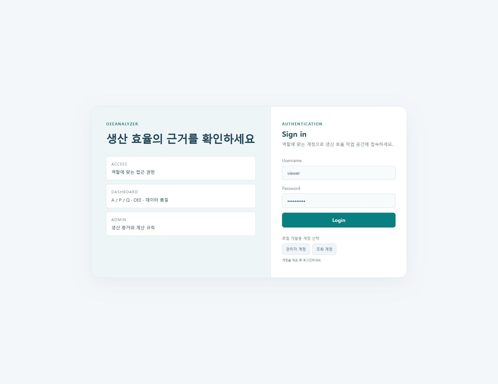
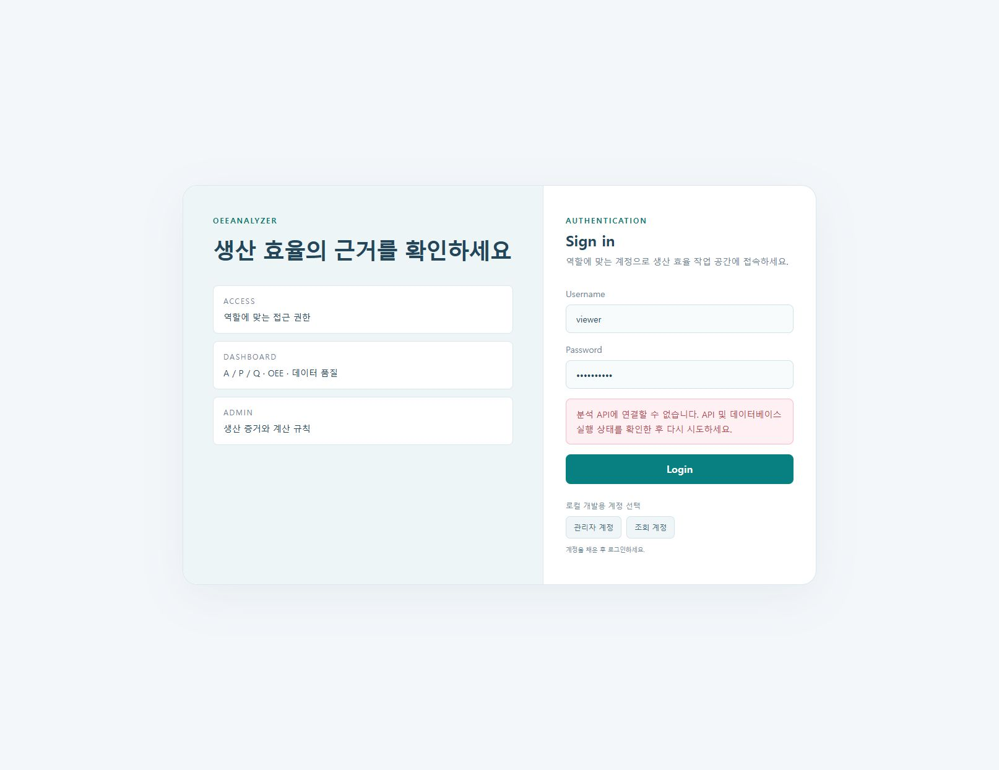

# OEEAnalyzer — 접근·효율 분석과 미연결 대응 사용 매뉴얼

접속: http://127.0.0.1:5185/login

현재 접근 가능한 로그인 화면·개발 계정 선택·API 연결 실패 대응을 안내한다. 분석 기간 조회, 계산 상태별 CSV, 조회 전용 대시보드는 소스에 근거한 API 복구 후 절차이며 현 환경에서 실행 확인하지 않았다.

## 준비

- React UI는 http://127.0.0.1:5185, 분석 API 목표 주소는 http://127.0.0.1:5184다. /api와 /hubs는 UI 개발 서버에서 API로 프록시된다.
- 현재 알려진 환경 제약은 Docker 엔진 시작 실패와 API 미연결이다. 로그인 화면이 열린 사실만으로 인증·계산·데이터 연동이 정상임을 의미하지 않는다.
- 정상 분석에는 API와 기존 MySQL·TimescaleDB·Redis 등 구성된 데이터 서비스, 유효 계정과 역할, 생산 증거 및 TwinForge 생산 맥락이 필요하다.
- 개발 계정 선택 버튼은 개발 서버(import.meta.env.DEV)에서만 표시된다. 버튼은 입력값을 채우며 계정을 생성하거나 자동 인증하지 않는다. 기존 DB에서 해당 계정의 존재를 보장하지 않는다.
- 새 운영 계정 초기화·비밀번호 변경은 관리자가 기존 인증 및 Bootstrap 정책에 따라 수행한다. 본 매뉴얼은 인증 우회나 계정 재생성을 안내하지 않는다.

실행 검증은 주요 동작의 관측 결과입니다. 문제 해결 분기 전체의 실행을 뜻하지 않습니다.

## 1. 로그인 화면 열기와 접근 역할 확인

분석 작업 공간의 진입 화면과 계정 입력 위치를 확인한다.

검증 상태: 실행 확인

1. http://127.0.0.1:5185/login을 연다.
2. 왼쪽 '생산 효율의 근거를 확인하세요' 안내와 Access·Dashboard·Admin 설명을 확인한다.
3. 오른쪽 Sign in 영역의 Username, Password, Login 버튼을 확인한다.
4. 개인에게 부여된 계정이 있으면 Username과 Password에 입력한다. 비밀번호는 가림 표시로 입력된다.
5. API가 미연결인 현재 환경에서는 입력 화면 확인과 인증 성공을 구분한다. 인증 결과는 다음 조작에서 확인한다.

기대 결과: 로그인 폼과 역할별 작업 영역 안내가 보인다. 비어 있는 필수 입력으로는 제출이 제한된다.

관측 결과: OEE 로그인 화면과 역할별 로컬 계정 프리셋 확인.

캡처 시각(UTC): 2026-10-23T17:13:55.002Z

문제 해결:

- 페이지가 열리지 않으면 UI 5185 프로세스를 확인한다.
- 관리 화면 주소로 직접 진입해도 세션이 없으면 로그인으로 이동한다. URL 입력은 인증을 대체하지 않는다.
- 세션이 만료되었으면 승인된 계정으로 다시 로그인한다.

## 2. 개발용 관리자·조회 계정 입력 선택

개발 환경의 계정 채우기 기능과 역할 차이를 이해한다.

검증 상태: 실행 확인

1. 로그인 폼 아래 '로컬 개발용 계정 선택' 영역이 표시되는지 확인한다.
2. '관리자 계정'을 눌러 Username이 admin으로 채워지고 Password가 가림 표시로 채워지는지 확인한다.
3. '조회 계정'을 눌러 Username이 viewer로 바뀌는지 확인한다.
4. 접근하려는 작업에 맞는 계정을 다시 선택한다. 분석·설계는 관리자 권한, 조회 대시보드는 조회 권한이 필요하다.
5. 이 단계에서는 버튼 선택과 로그인 성공을 구분한다. 실제 계정 검증은 Login 제출 시 API가 수행한다.

기대 결과: 선택 버튼에 따라 입력값이 바뀌고 이전 오류가 지워진다. 인증 성공·계정 생성은 발생하지 않는다.

관측 결과: 조회 계정 프리셋으로 입력 필드 채움. 암호는 마스킹된 UI만 캡처.

캡처 시각(UTC): 2026-10-23T17:13:55.364Z

문제 해결:

- 선택 버튼이 없으면 운영 빌드일 수 있다. 승인된 계정 정보를 직접 입력한다.
- 자동 입력값으로 인증이 거부되면 해당 DB에 개발 계정이 존재하는지 관리자에게 확인한다.
- 계정 선택만으로 페이지가 이동하지 않는 것은 정상이다.

## 3. 로그인 제출 후 API 오류 구분

잘못된 계정과 분석 API 미연결을 구분하고 적절한 재시도를 한다.

검증 상태: 실행 확인

1. 개발 계정 선택 또는 승인된 계정 입력으로 필수 항목을 채운다.
2. 'Login'을 한 번 누른다. 처리 중 'Signing in...'과 버튼 비활성화를 확인한다.
3. 현재 API 미연결 환경에서는 '분석 API에 연결할 수 없습니다. API 및 데이터베이스 실행 상태를 확인한 후 다시 시도하세요.' 안내를 확인한다.
4. API가 401을 반환하는 경우에는 '계정 정보가 올바르지 않습니다. 아이디와 비밀번호를 확인하세요.'로 구분된다. 실제 나타난 문구만 기록한다.
5. API 또는 데이터 서비스가 복구된 뒤 재시도한다. 응답 대기 제한은 15초지만 연결 거부는 더 빨리 오류가 나타날 수 있다.
6. 정상 인증 시 관리자는 /admin/dashboard-manager, 조회자는 /viewer로 이동하는지를 별도로 확인한다. 현재의 오류 화면을 인증 성공 근거로 사용하지 않는다.

기대 결과: API 미연결 또는 인증 거부 안내가 표시되고 재시도 가능한 상태로 돌아온다. 401 이외의 서버 오류도 API 연결 오류 안내에 포함되므로 원인 확정에는 서버 상태 확인이 필요하다.

관측 결과: 조회 계정 로그인 시 분석 API 연결 불가 오류 확인. 로그인 이후 기능 미검증.

캡처 시각(UTC): 2026-10-23T17:14:01.665Z

문제 해결:

- 오류가 나면 비밀번호를 반복 변경하기 전에 API 5184와 DB 서비스 상태를 확인한다.
- UI 5185는 열리는데 로그인만 실패하면 프론트엔드 접근 성공과 백엔드 정상 여부를 구분한다.
- API가 살아난 뒤에도 401이면 기존 계정·역할·비밀번호를 관리자에게 확인한다.

## 4. 생산 증거와 OEE 분석 기간 조회

API 복구 후 설비 키와 기간에 맞는 계산 창을 조회한다.

검증 상태: 실행 미확인 · 백엔드 복구 후 확인 필요

1. API·데이터 서비스와 관리자 인증을 복구한 뒤 관리자 계정으로 로그인한다.
2. 왼쪽 '생산 증거와 OEE'를 선택하거나 인증 상태에서 http://127.0.0.1:5185/admin/integration으로 이동한다.
3. Integration Route에서 PLC Simulation→IIoT Gateway→TwinForge MES→OEEAnalyzer의 책임 구분을 확인한다.
4. Analysis Window의 Equipment Key에 등록된 설비 키를 입력한다. 기본 예시는 demo/automotive/main-conveyor다.
5. '최근 1시간', '최근 8시간', '최근 24시간' 중 하나를 누르면 기간이 바뀌면서 조회된다. 사용자 지정 기간은 From과 To를 입력하고 'Refresh Analysis'를 누른다.
6. Window Status, Availability, Performance, Quality, OEE와 Coverage를 함께 확인한다. 화면의 From·To 입력은 로컬 시각이며 요청 시 UTC로 변환된다.
7. Final 여부와 reasons·revision을 확인한다. N/A와 빈 결과를 0% 또는 생산 중단으로 바꾸어 해석하지 않는다.

기대 결과: 복구 후에는 선택 기간의 계산 창과 최종 조회 시각이 나타난다. 생산 맥락이 겹치지 않으면 Awaiting production context 안내가 나올 수 있다. 현재 환경에서는 이 절차를 실행 확인하지 않았다.

현재 환경에서 실행하지 못했으므로 성공 화면을 제공하지 않습니다. PPT/PDF의 설명도는 실제 앱 화면과 구분됩니다.

문제 해결:

- 시작 시각이 종료 시각보다 빠른지, 설비 키가 비어 있지 않은지 확인한다.
- 결과가 없으면 TwinForge 생산 맥락과 PLC/Gateway 표본의 설비 키·기간을 맞춘다.
- Incomplete·Invalid·Provisional이면 coverage와 reasons를 읽고 부족·오류 증거를 먼저 해결한다.

## 5. 계산 상태 필터와 OEE CSV 내보내기

API 복구 후 검토할 계산 상태만 모아 근거와 함께 내보낸다.

검증 상태: 실행 미확인 · 백엔드 복구 후 확인 필요

1. 관리자 '생산 증거와 OEE'에서 분석 조회가 끝나고 OEE Window Ledger에 결과가 있는지 확인한다.
2. '계산 상태'에서 전체 상태 또는 Final·Provisional·Invalid·Incomplete·NotApplicable 중 하나를 고른다.
3. 필터 결과 수와 전체 계산 창 수를 비교하고, 표의 기간·A/P/Q·OEE·Coverage·Production·Revision·Diagnostics를 확인한다.
4. 'CSV 내보내기 ↓'를 누르고 oee-windows-YYYY-MM-DD.csv 다운로드를 확인한다.
5. CSV에서 contextId, fromUtc, toUtc, status, sourceMode, availability, performance, quality, oee, coverage, total, reject, revision, reasons 열을 확인한다.
6. CSV의 비율은 화면의 퍼센트 문자열이 아닌 원래 수치다. null은 빈 셀로 저장될 수 있다. 내보낸 행 수가 필터 결과 수와 맞는지 확인한다.

기대 결과: 현재 필터에 맞는 계산 창이 UTC 기간·품질 사유·계산 revision을 포함한 CSV로 저장된다. 결과가 없거나 조회 중이면 내보내기가 비활성화된다. 현재 환경에서는 실행 확인하지 않았다.

현재 환경에서 실행하지 못했으므로 성공 화면을 제공하지 않습니다. PPT/PDF의 설명도는 실제 앱 화면과 구분됩니다.

문제 해결:

- 상태를 고른 뒤 결과가 0개면 '전체 상태'로 돌아가 다른 계산 상태가 있는지 확인한다.
- CSV 버튼이 비활성화되면 조회 중인지 또는 필터 결과가 없는지 확인한다.
- 모의 출처 Demo를 External 실측 증거로 표시하지 않는다. Final 여부와 sourceMode를 별도로 확인한다.

## 6. 조회 전용 효율 모니터와 로그아웃

API 복구 후 조회 권한으로 허용된 위젯·갱신 시각을 읽고 세션을 종료한다.

검증 상태: 실행 미확인 · 백엔드 복구 후 확인 필요

1. API·데이터 서비스가 정상인 환경에서 조회 계정으로 로그인한다.
2. /viewer의 Live Dashboard에서 Session active, Last update, Widgets, Loaded Values, Mode를 확인한다.
3. Viewer Dashboard의 배정 위젯 값을 읽는다. 조회 모드에서는 위젯을 이동·크기 조절할 수 없다.
4. 현재값과 추세의 마지막 갱신 시각을 확인한다. 실시간 갱신은 SignalR, 초기 현재값은 REST 응답을 사용한다.
5. 'No dashboard widgets'가 보이면 현재 계정에 배정된 레이아웃·위젯 권한을 관리자에게 확인한다.
6. 상단 '로그아웃 ↗'을 누르고 /login으로 돌아가는지 확인한다.

기대 결과: 계정에 허용된 위젯을 읽기 전용으로 확인하고 로그아웃 후 로그인 화면으로 돌아온다. 현재 환경에서는 인증과 데이터 조회를 실행 확인하지 않았다.

현재 환경에서 실행하지 못했으므로 성공 화면을 제공하지 않습니다. PPT/PDF의 설명도는 실제 앱 화면과 구분됩니다.

문제 해결:

- 뷰어 계정으로 관리자 URL에 접근하면 /viewer로 이동할 수 있다. 권한 오류를 우회하지 않는다.
- 값이 비거나 No updates이면 데이터 유입·태그 바인딩·세션 상태를 확인한다.
- 실시간 갱신이 멈추면 Last update와 연결 상태를 확인하고 필요 시 재로그인한다.

## 구현 근거

- `OEEAnalyzer/OeeMccSolution/src/Frontend/src/pages/LoginPage.tsx`
- `OEEAnalyzer/OeeMccSolution/src/Frontend/src/pages/AdminIntegrationPage.tsx`
- `OEEAnalyzer/OeeMccSolution/src/Frontend/src/pages/ViewerPage.tsx`
- `OEEAnalyzer/OeeMccSolution/src/Frontend/src/components/Layout.tsx`
- `OEEAnalyzer/OeeMccSolution/src/Frontend/src/App.tsx`
- `OEEAnalyzer/OeeMccSolution/src/Frontend/src/services/api.ts`
- `OEEAnalyzer/OeeMccSolution/src/Frontend/src/services/types.ts`
- `OEEAnalyzer/OeeMccSolution/src/Frontend/vite.config.ts`
- `OEEAnalyzer/README.md`
