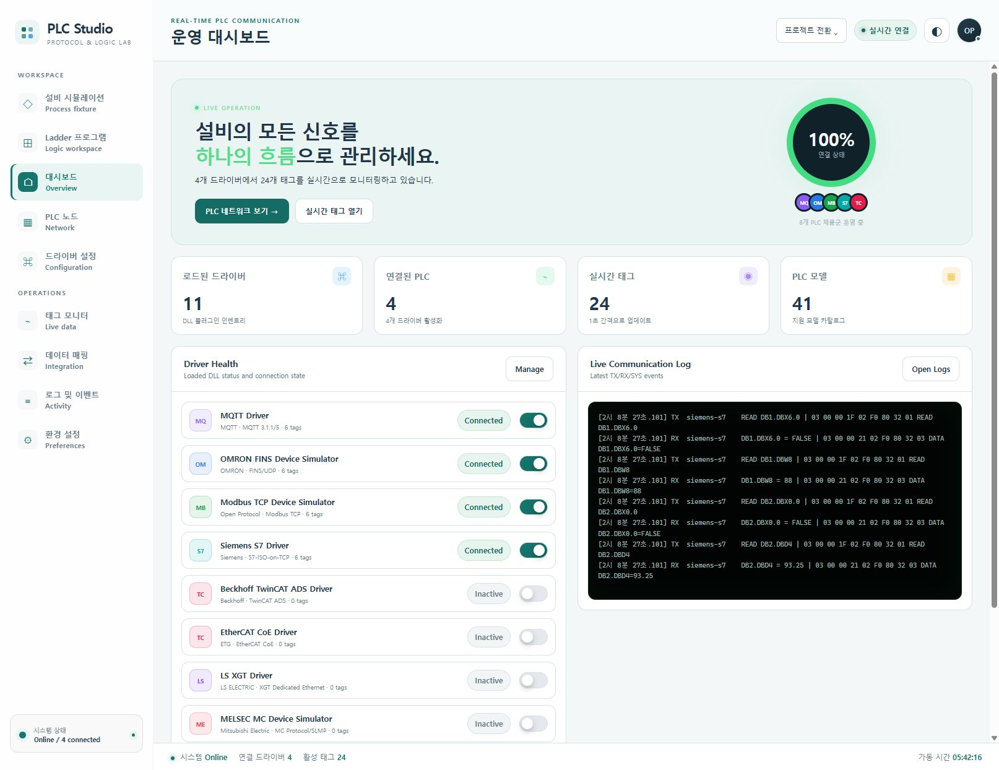
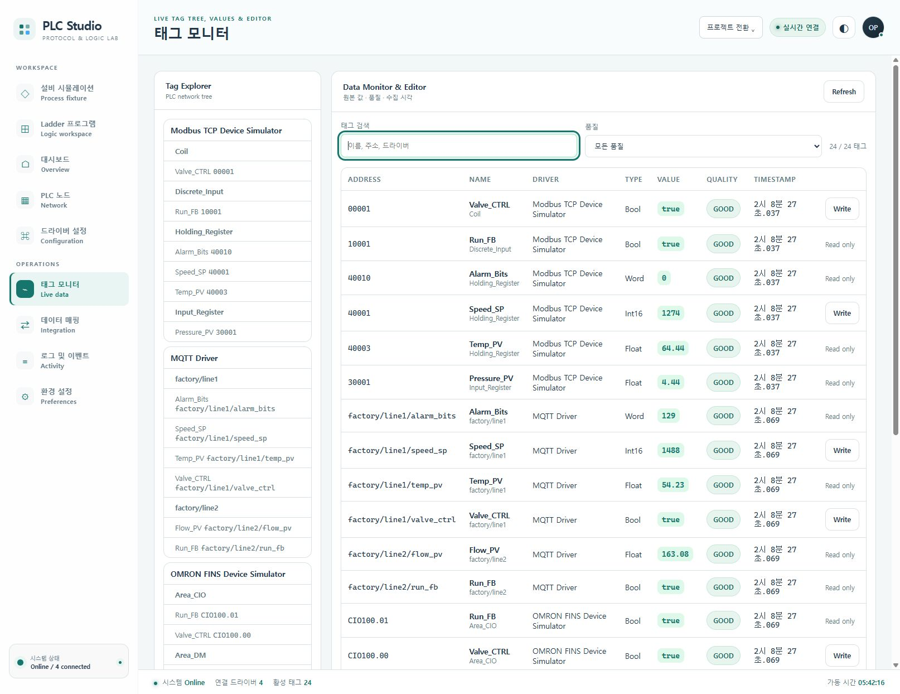
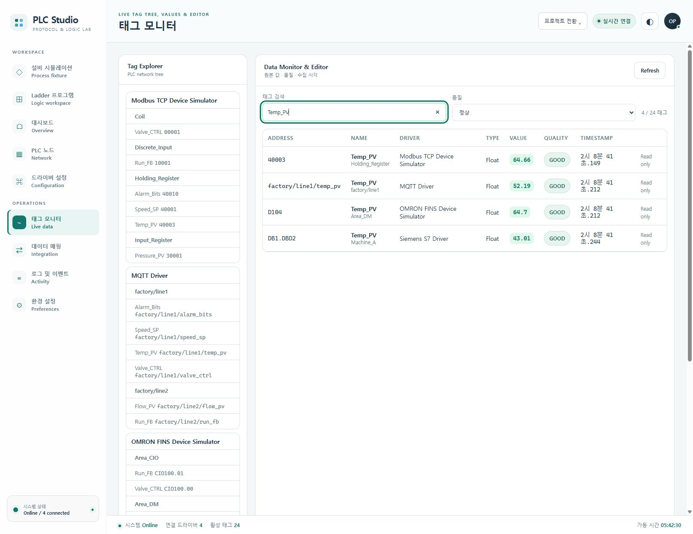
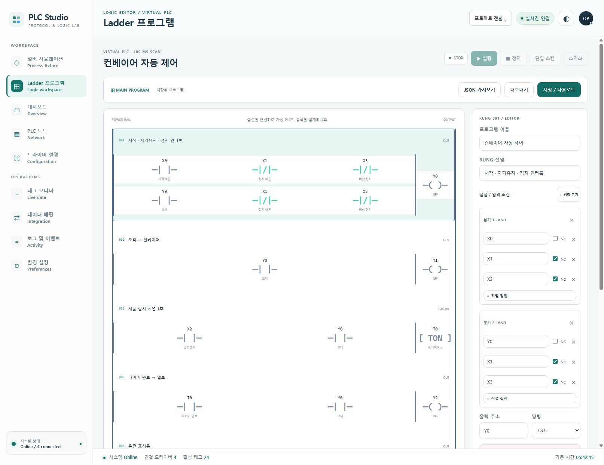
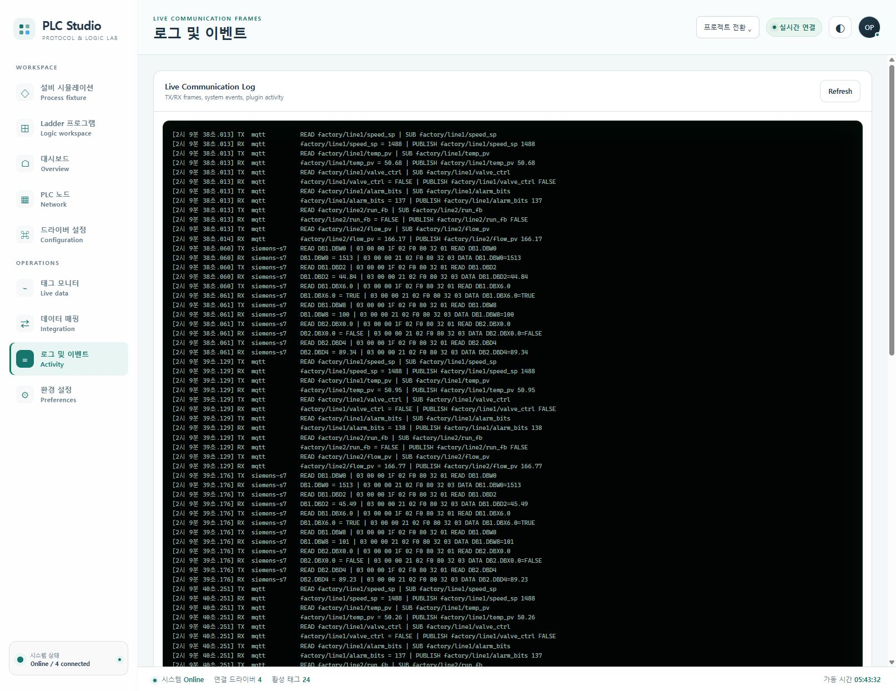

# PLC Studio 사용 매뉴얼

접속: http://127.0.0.1:5180/

가상 PLC의 상태 조회, 원본 태그 관측·검색, 가상 Ladder 단일 스캔과 통신 로그 확인. 설비 시뮬레이션의 모터·컨베이어 그림은 가상 장치이며 물리 설비의 운전을 증명하지 않습니다.

## 준비

- 로컬 PLC Studio 서버가 http://127.0.0.1:5180/ 에서 실행 중이어야 합니다. 파일을 직접 여는 file:// 미리보기에서는 통신할 수 없습니다.
- 태그 조회에는 적어도 하나의 활성 드라이버가 필요합니다. 드라이버의 Enabled 상태와 Connected 상태는 서로 다릅니다.
- Ladder 실습은 다른 사용자의 운전과 겹치지 않는 가상 실습 환경에서 진행합니다. 아래 단일 스캔 실습은 PLC 드라이버 태그 연결이 모두 '가상 I/O'인 경우를 전제로 합니다.
- 화면 수치와 접속 상태는 캡처 시점의 값입니다. 고정된 드라이버 수나 태그 수를 정상 판정 기준으로 사용하지 않습니다.

실행 검증은 주요 동작의 관측 결과입니다. 문제 해결 분기 전체의 실행을 뜻하지 않습니다.

## 1. 운영 대시보드에서 드라이버와 태그 현황 확인

서버 연결과 활성 드라이버·연결된 PLC·실시간 태그 수를 구분해 확인합니다.

검증 상태: 실행 확인

1. http://127.0.0.1:5180/ 에 접속하고 왼쪽 '대시보드'를 누릅니다. 첫 화면은 마지막 방문 메뉴에 따라 달라질 수 있습니다.
2. 오른쪽 위 연결 배지에서 '실시간 연결', '재연결 중' 또는 '연결 오류'를 확인합니다.
3. '로드된 드라이버', '연결된 PLC', '실시간 태그', 'PLC 모델' 카드와 아래 'Driver Health' 목록의 상태를 읽습니다.
4. 필요하면 'PLC 네트워크 보기 →'를 눌러 노드별 ENDPOINT와 '정상 품질 태그' 비율을 확인합니다.
5. 원복: 왼쪽 '대시보드'를 다시 누릅니다. 이 조회와 메뉴 이동은 드라이버 설정이나 태그 값을 바꾸지 않습니다.

기대 결과: 서버에서 받은 현재 카운트와 각 드라이버 상태가 표시됩니다. 활성화되어 있어도 미연결일 수 있으며, 모델 카탈로그 수는 실제 연결된 장치 수가 아닙니다.

관측 결과: 대시보드에서4개연결드라이버/24개태그와모의소스표시 확인

캡처 시각(UTC): 2026-10-23T17:08:28.046Z

문제 해결:

- '파일 미리보기' 또는 '로컬 서버 실행 필요'가 보이면 브라우저에서 HTTP 주소로 다시 접속합니다.
- '연결된 PLC'가 0이면 드라이버 목록과 '로그 및 이벤트'를 함께 확인합니다. 태그 수만으로 통신 성공을 판정하지 않습니다.

## 2. 태그의 원본 값·품질·수집 시각 확인

태그 이름뿐 아니라 주소, 데이터 형식, 품질과 갱신 시각을 함께 읽습니다.

검증 상태: 실행 확인

1. 왼쪽 '태그 모니터'를 누릅니다. 'Tag Explorer'와 'Data Monitor & Editor'가 나란히 표시됩니다.
2. Tag Explorer에서 확인할 태그를 선택하고 표에서 Address, Name, Driver, Type을 대조합니다.
3. Value, Quality, Timestamp를 함께 확인합니다. Timestamp는 브라우저의 로컬 시간 표기입니다.
4. 오른쪽 'Refresh'를 눌러 현재 서버 스냅샷을 다시 가져옵니다. 평상시에는 실시간 연결로 값과 시각이 갱신됩니다.
5. 원복: 조회만 수행했다면 원복할 설정이 없습니다. 이 절차에서는 'Write'를 누르지 않습니다.

기대 결과: 표에 드라이버가 제공한 값과 품질이 표시됩니다. GOOD은 해당 태그의 품질 정보이며, 값이 존재한다는 사실만으로 전체 설비가 정상이라는 뜻은 아닙니다.

관측 결과: 전체24태그의값/품질/타임스탬프 표시

캡처 시각(UTC): 2026-10-23T17:08:28.552Z

문제 해결:

- 'No tags discovered'이면 드라이버 활성화와 연결 상태를 먼저 확인합니다.
- 시각이 멈추거나 GOOD 이외의 품질이 표시되면 Refresh 후 로그를 확인합니다. 이전에 보인 값을 최신 데이터로 기록하지 않습니다.

## 3. 태그 이름·주소·품질로 목록 좁히기

필요한 태그 또는 확인이 필요한 품질만 빠르게 찾습니다.

검증 상태: 실행 확인

1. '태그 모니터'에서 '태그 검색' 입력칸을 찾습니다. 자리표시자는 '이름, 주소, 드라이버'입니다.
2. 현재 표에 있는 태그 이름이나 주소의 일부를 입력합니다. 대소문자를 구분하지 않으며 이름·주소·드라이버·그룹을 함께 검색합니다.
3. '품질'을 기본 '모든 품질'에서 '정상' 또는 '확인 필요'로 바꿉니다. '정상'은 GOOD 품질만 남깁니다.
4. '표시 건수 / 전체 태그 수'와 결과를 확인합니다. 검색 중에도 값·품질·시각은 갱신됩니다.
5. 원복: 검색어를 지우고 품질을 '모든 품질'로 되돌립니다.

기대 결과: 검색어와 품질 조건을 동시에 만족하는 태그만 남고 결과 건수가 바뀝니다. 검색 결과가 0이면 '검색 조건에 맞는 태그가 없습니다.'가 표시됩니다. 필터는 원본 태그나 드라이버를 변경하지 않습니다.

관측 결과: Temp_PV검색+정상품질필터4/24태그확인

캡처 시각(UTC): 2026-10-23T17:08:42.206Z

문제 해결:

- 결과가 없으면 검색어를 지우고 '모든 품질'로 돌아가 원본 목록이 있는지 확인합니다.
- '확인 필요' 결과가 0인 것은 필터에 해당하는 태그가 없다는 뜻입니다. 개별 장치의 운전 안전성을 판정한 결과는 아닙니다.

## 4. 가상 Ladder를 정지 상태에서 한 번 스캔

연속 운전 없이 접점과 출력 코일의 계산 결과를 관찰합니다.

검증 상태: 실행 확인

1. 왼쪽 'Ladder 프로그램'을 누르고 현재 프로그램을 확인합니다. 편집 전 보관이 필요하면 '내보내기'로 ladder-program.json을 저장합니다.
2. 아래 'PLC 드라이버 태그 연결'에서 실습 대상 I/O가 '가상 I/O'인지 확인합니다. 외부 태그가 연결되어 있다면 이 실습을 진행하지 않고 담당자에게 구성 확인을 요청합니다.
3. '■ 정지'를 누르고 상태가 '■ STOP'인지 확인한 뒤 '초기화'를 눌러 가상 신호와 타이머 상태를 초기화합니다.
4. '단일 스캔'을 한 번 누르고 Rung의 접점·코일 상태를 확인합니다. 초기 입력이 OFF이면 출력도 OFF일 수 있습니다.
5. 원복: '초기화'를 눌러 STOP과 초기 신호 상태로 돌아갑니다. 이 절차에서는 프로그램을 편집하거나 '저장 / 다운로드'를 누르지 않습니다.

기대 결과: 단일 스캔은 100ms 기준 계산 한 번을 수행하고 STOP 상태를 유지합니다. 초기화는 런타임 신호·타이머를 지우며 저장된 Ladder 프로그램 자체를 삭제하지 않습니다.

관측 결과: 가상I/O 기본프로그램에서 단일스캔 수행, 실제드라이버태그쓰기연결 없음

캡처 시각(UTC): 2026-10-23T17:08:57.617Z

문제 해결:

- '단일 스캔은 STOP 상태에서 실행하세요.'가 표시되면 먼저 ■ 정지를 누릅니다.
- '편집한 프로그램을 먼저 저장하세요.'가 나오면 의도하지 않은 편집 여부를 확인합니다. 현재 프로그램을 덮어써서 진행하지 말고 보관한 프로그램과 변경 내용을 검토합니다.

## 5. 통신 로그를 새로고침하고 장애 단서 확인

드라이버 연결 문제를 시간·대상·오류 메시지로 좁힙니다.

검증 상태: 실행 확인

1. 왼쪽 '로그 및 이벤트'를 누릅니다.
2. 'Live Communication Log'에서 TX/RX 프레임, 시스템 이벤트와 오류·경고 항목을 읽습니다.
3. 'Refresh'를 눌러 서버가 보관하는 최근 로그를 다시 가져옵니다.
4. 동일 시각의 드라이버 상태와 태그 품질을 대조합니다. 로그가 없는 경우 그 사실을 그대로 기록합니다.
5. 원복: 다른 메뉴로 이동하면 됩니다. Refresh는 로그 삭제나 드라이버 재시작을 수행하지 않습니다.

기대 결과: 최근 통신·시스템 로그가 표시됩니다. 이 화면은 무제한 감사 기록 보관소가 아니며 최근 로그 범위만 보여줍니다.

관측 결과: Refresh 조작후통신송수신로그 표시

캡처 시각(UTC): 2026-10-23T17:09:43.714Z

문제 해결:

- 'No logs yet'이면 아직 기록된 이벤트가 없거나 서버 재시작 직후인지 확인합니다.
- 오류가 반복되면 대상 드라이버, 발생 시각과 메시지를 함께 전달합니다. 로그만 보고 포트나 장치 설정을 임의로 바꾸지 않습니다.

## 구현 근거

- `PLC_Simulation/src/PlcSimulator.Web/wwwroot/index.html`
- `PLC_Simulation/src/PlcSimulator.Web/wwwroot/js/app.js`
- `PLC_Simulation/src/PlcSimulator.Web/wwwroot/js/studio.js`
- `PLC_Simulation/src/PlcSimulator.Web/LadderRuntime.cs`
- `PLC_Simulation/src/PlcSimulator.Core/Ladder/LadderEngine.cs`
