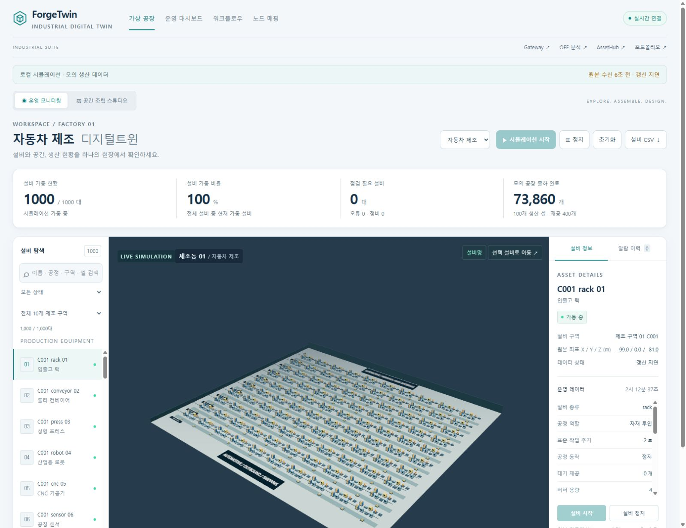
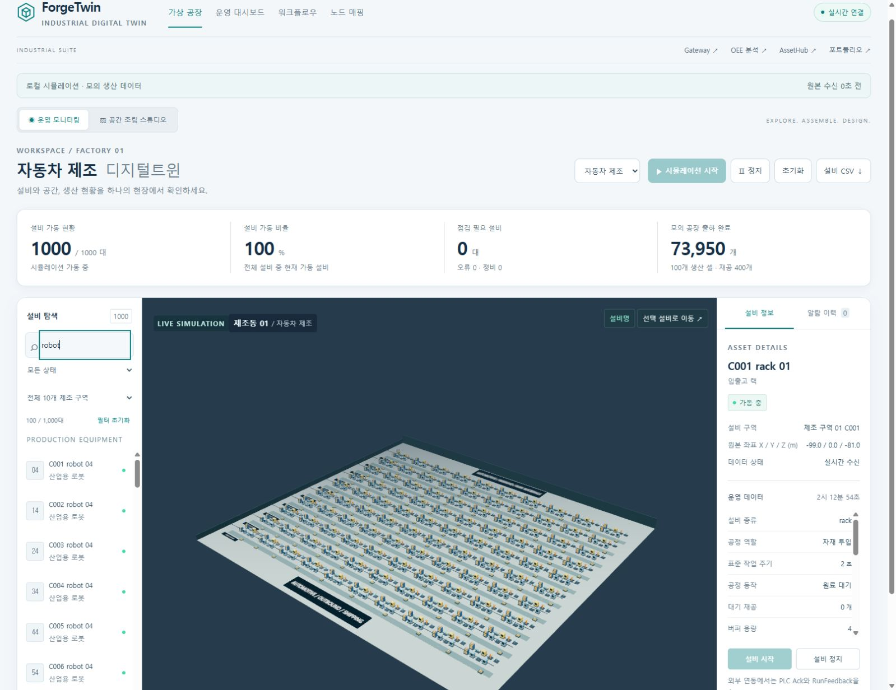
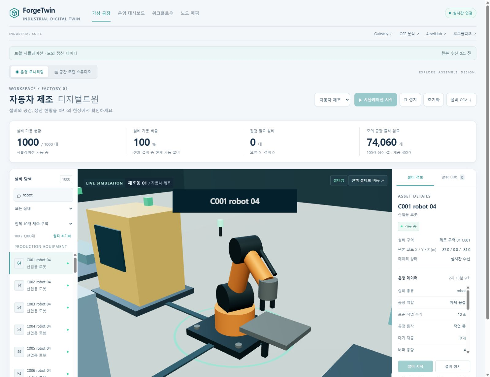
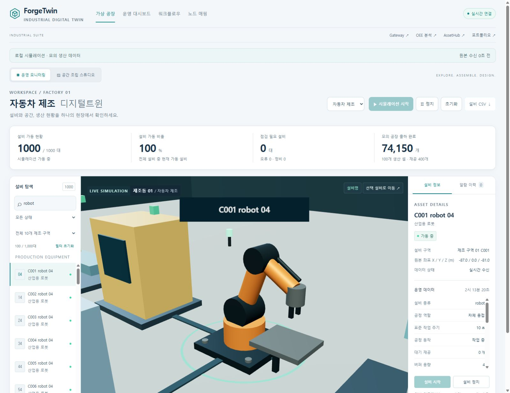
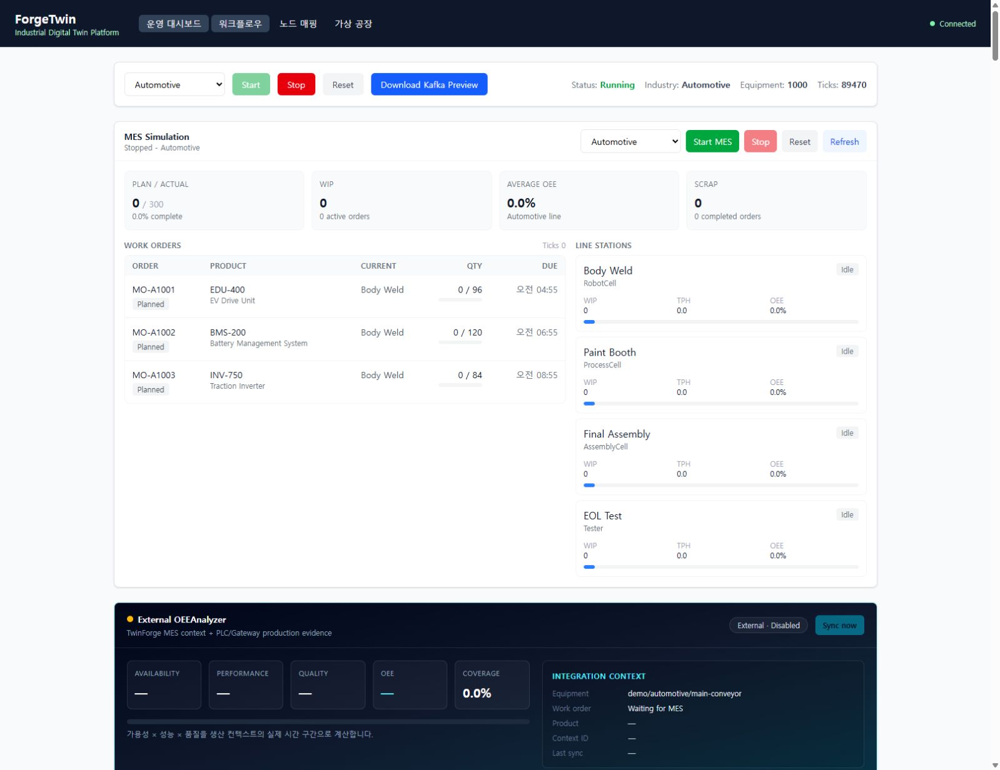

# TwinForge — 가상 공장 운영과 작업 공간 사용 매뉴얼

접속: http://127.0.0.1:5182/

로컬 대규모 공장 시뮬레이션의 연결 상태, 시작·정지, 설비 탐색·제어, 3D 카메라, CSV, 운영 대시보드·워크플로우·매핑 화면을 안내한다. 실제 PLC 제어 또는 외부 OEE 정상 연동을 검증한 문서로 해석하지 않는다.

## 준비

- TwinForge API가 http://127.0.0.1:5183, React UI가 http://127.0.0.1:5182에서 실행되어야 한다.
- UI의 /api 및 /hubs 요청은 기본적으로 API 5183으로 프록시된다. 별도 API는 TWIN_API_TARGET 또는 VITE_API_URL 설정을 확인한다.
- 이 매뉴얼의 대상은 '로컬 시뮬레이션 · 모의 생산 데이터' 모드다. 1,000대 배치는 UseLargeFactory 설정이 활성화된 경우다.
- 화면이 이미 실행 중이면 기존 결과를 먼저 확인한다. 초기화는 공장 상태를 변경하므로 기존 기록이 필요한 작업에서는 누르지 않는다.
- 브라우저 다운로드를 허용한다. 원본 수신 경과 시간은 선택 설비 텔레메트리 또는 공장 프레임의 시간 기준이며 데이터 품질 전체를 보증하는 지표는 아니다.

실행 검증은 주요 동작의 관측 결과입니다. 문제 해결 분기 전체의 실행을 뜻하지 않습니다.

## 1. 연결 상태와 데이터 출처 확인

실시간 연결, 미리보기, 모의 생산 데이터를 구분하고 갱신 지연을 파악한다.

검증 상태: 실행 확인

1. 브라우저에서 http://127.0.0.1:5182/를 연다. 상단 '가상 공장'과 '운영 모니터링'이 선택되었는지 확인한다.
2. 오른쪽 연결 배지에서 '실시간 연결' 여부를 확인한다. '연결 중', '재연결 중', '연결 끊김'이면 이를 먼저 기록한다.
3. 상단 안내에서 '로컬 시뮬레이션 · 모의 생산 데이터'를 확인한다. 외부 PLC 모드가 표시되면 이 매뉴얼의 모의 공장 전제를 적용하지 않는다.
4. 안내 오른쪽의 '원본 수신 N초 전'과 '갱신 지연' 표시를 확인한다. 5초를 초과하면 지연 표시가 나타난다.
5. 설비 가동 현황·가동 비율·점검 필요 설비·모의 출하 완료 카드를 확인한다. 미리보기의 '—'는 측정값 0과 구분한다.

기대 결과: 데이터 출처와 연결 상태를 설명할 수 있고, 미리보기와 수신된 공장 상태를 구분한다. 연결 중단 후 보이는 값은 마지막 수신 상태다.

관측 결과: 로컬 모의 공장1000대, 전체 조망, 원본 수신0초 확인.

캡처 시각(UTC): 2026-10-23T17:13:40.202Z

문제 해결:

- 화면이 열리지 않으면 UI 5182 실행 여부를 확인한다.
- UI만 열리고 연결이 끊기면 API 5183과 /hubs 프록시를 확인한 뒤 다시 접속한다.
- 원본 시간이 오래되면 실행 정지 여부와 연결 상태를 함께 확인한다. 경과 시간만으로 설비 고장으로 단정하지 않는다.

## 2. 업종 선택 후 공장 시작·정지

선택 업종의 로컬 시뮬레이션을 실행하고 정지 상태를 확인한다.

검증 상태: 실행 확인

1. 이미 가동 중이면 업종을 바꾸지 말고 현재 업종과 설비 수를 기록한다. 새 업종으로 시작할 때만 'Ⅱ 정지'를 눌러 정지한다.
2. 정지 상태에서 '공장 업종' 선택 상자로 업종을 고른다. 가동 중이거나 명령 처리 중이면 업종 변경이 비활성화된다.
3. '▶ 시뮬레이션 시작'을 한 번 누르고 명령 처리를 기다린다. 이미 가동 중이면 시작 버튼이 비활성화된다.
4. 상태가 가동 중으로 바뀌고 설비 목록·3D 장면·수신 틱이 갱신되는지 확인한다. 대규모 모드에서는 1,000대 배치와 제조 구역 필터가 표시된다.
5. 'Ⅱ 정지'를 눌러 시뮬레이션 정지 표시를 확인한다. 필요하면 같은 업종으로 다시 시작한다.
6. '초기화'는 별도 실습에서만 사용한다. 초기화 후에는 설비·누계·상태가 바뀔 수 있으므로 실행 전 필요한 CSV를 먼저 저장한다.

기대 결과: 시작 시 선택 업종의 설비와 갱신 상태가 나타나고, 정지 시 시뮬레이션 정지가 표시된다. 수치는 확률적 고장과 공정 진행에 따라 달라질 수 있다.

관측 결과: 로컬 시뮬레이션을 정지 후 시작, 1000대 가동 및 수신 틱 증가 확인. 실제 공장 데이터 아님.

캡처 시각(UTC): 2026-10-23T17:12:44.335Z

문제 해결:

- 명령 오류 배너가 나타나면 API 응답과 연결 상태를 확인한다. 버튼을 반복해서 누르지 않는다.
- 시작 버튼이 비활성화되어 있으면 이미 실행 중인지 확인한다.
- 로컬 시뮬레이션 대신 외부 PLC 모드면 제어 허용과 PLC Ack·RunFeedback에 따른 별도 운영 절차가 필요하다.

## 3. 설비 검색·상태·구역 필터 적용

대규모 공장에서 원하는 설비 집합을 좁히고 전체 목록으로 복귀한다.

검증 상태: 실행 확인

1. 왼쪽 '설비 탐색'의 검색창에 현재 보이는 설비 이름 일부를 입력한다. 이름·종류·구역·셀·공정 역할을 검색할 수 있다.
2. '모든 상태' 선택 상자에서 필요한 설비 상태를 고른다. 검색어와 상태 조건은 함께 적용된다.
3. 대규모 배치일 때 '전체 10개 제조 구역' 선택 상자에서 구역을 고른다.
4. 필터 요약의 '검색 결과 수 / 전체 설비 수'를 확인한다. 결과가 50대를 넘으면 목록 아래 '이전'·'다음'을 사용한다.
5. 원하는 설비 행을 눌러 오른쪽 설비 정보가 해당 항목으로 바뀌는지 확인한다.
6. '필터 초기화'를 눌러 검색어·상태·구역 조건을 모두 해제한다.

기대 결과: 조건에 맞는 설비만 목록에 남고 결과 수가 바뀐다. 조건 변경 시 목록 페이지는 처음으로 돌아간다. 필터 초기화 후 전체 설비를 탐색할 수 있다.

관측 결과: robot 검색으로 100/1000대 표시. 검색 결과에만 CSV 적용.

캡처 시각(UTC): 2026-10-23T17:12:55.678Z

문제 해결:

- 검색 결과가 없으면 검색어뿐 아니라 상태와 구역 조건도 확인한다.
- 구역 선택이 없으면 대규모 공장 배치인지 확인한다.
- 검색과 필터는 탐색 목록을 제한한다. 3D 장면에서 전체 설비가 보이는 것은 오류가 아니다.

## 4. 설비 상세·카메라·개별 제어

선택 설비의 위치와 운영 데이터를 확인하고 가능한 제어를 수행한다.

검증 상태: 실행 확인

1. 설비 목록의 한 행 또는 3D 장면의 설비를 클릭한다. 오른쪽 '설비 정보'에서 이름과 설비 종류를 대조한다.
2. '설비 구역', 원본 좌표, 데이터 상태와 '운영 데이터'의 시각·값을 확인한다.
3. '선택 설비로 이동 ↗'를 눌러 선택 대상을 중심으로 카메라를 이동한다.
4. 장면 아래 '전체 조망', '현장 시점', '평면 보기'를 차례로 선택한다. 드래그는 회전, 우클릭 드래그는 이동, 휠은 확대·축소다.
5. 가동 중인 로컬 시뮬레이션에서 선택 설비의 '설비 정지'를 누르고 상태 변화를 확인한다. 정지한 설비를 다시 운전할 때 '설비 시작'을 사용한다.
6. '알람 이력' 탭에서 수신 이력을 확인한다. 알람 행을 누르면 현재 배치에 존재하는 설비의 정보로 이동한다.

기대 결과: 선택 설비와 상세 정보가 일치하고 카메라 시점이 바뀐다. 허용 조건을 충족하는 경우만 개별 시작·정지 버튼이 활성화된다. 알람은 현재 고장 판정과 별개의 수신 이력이다.

관측 결과: C001 robot 04 선택 및 선택 설비로 카메라 이동. 설비 정보/원본 수신 확인.

캡처 시각(UTC): 2026-10-23T17:13:10.310Z

문제 해결:

- 미리보기에서는 개별 제어를 할 수 없다. 공장 실행 여부를 먼저 확인한다.
- 명령 처리 중에는 다른 설비 명령이 비활성화될 수 있다.
- 외부 연동에서 버튼 클릭만으로 제어 성공을 단정하지 않는다. PLC Ack와 RunFeedback을 확인한다.
- 3D 장면을 표시할 수 없으면 브라우저의 WebGL 지원과 렌더링 오류 안내를 확인한다.

## 5. 현재 필터 결과를 설비 CSV로 저장

화면에서 선택한 설비 집합을 출처·시간 정보와 함께 내려받는다.

검증 상태: 실행 확인

1. 공장을 실행하여 미리보기 상태를 벗어난다. 필요한 검색·상태·구역 조건을 적용한다.
2. 왼쪽 결과 수를 기록한다. 내보내기는 현재 목록 페이지 50대에 한정되지 않고 필터에 맞는 전체 설비가 대상이다.
3. 상단 '설비 CSV ↓'를 누른다. 브라우저가 저장 위치를 물으면 다운로드 폴더를 선택한다.
4. 'forgetwin-equipment-YYYY-MM-DD.csv' 파일이 내려받아졌는지 확인한다.
5. 파일에서 equipmentId, name, state, zone, cell, sourceMode, sourceTimestamp 열을 확인하고 결과 행 수를 필터 결과 수와 비교한다.

기대 결과: 현재 필터 결과가 UTF-8 CSV로 다운로드된다. 출처와 공장 프레임 시간이 포함되며 시간 값이 없는 경우 빈 셀일 수 있다. 날짜가 포함된 파일명은 내보내기 시점 UTC 날짜를 사용한다.

관측 결과: robot 검색 상태 CSV 버튼 실행. 다운로드 파일 twin-robot-filtered.csv 보관; 필터100대 확인.

캡처 시각(UTC): 2026-10-23T17:13:20.970Z

문제 해결:

- CSV 버튼이 비활성화되어 있으면 설비가 없는 미리보기인지 확인한다.
- 다운로드가 보이지 않으면 브라우저 다운로드 목록과 차단 표시를 확인한다.
- 검색 필터가 0건이면 머리글만 저장될 수 있다. 필터 초기화 후 다시 내보낼 수 있다.

## 6. 운영 대시보드·워크플로우·노드 매핑 탐색

현장 보기에서 분석·설계·연동 설정 작업 공간으로 이동하고 각 화면의 역할을 구분한다.

검증 상태: 실행 확인

1. 상단 '운영 대시보드'를 눌러 공장 상태와 설비 카드, MES Simulation, External OEEAnalyzer, Protocol·Telemetry·Alarm 패널을 찾는다.
2. Telemetry의 설비 선택 상자를 바꾸어 선택 설비 이벤트와 시각을 확인한다. External OEEAnalyzer가 비활성화·미연결이면 빈 OEE 값을 정상 연동 결과로 해석하지 않는다.
3. MES를 실습할 경우 MES Simulation의 업종을 확인하고 'Start MES'를 누른 뒤 Plan / Actual과 주문·공정 진행을 확인한다. MES는 공장 시뮬레이션과 구분되는 모의 생산 맥락이다.
4. 상단 '워크플로우'를 눌러 노드 팔레트·캔버스·속성 패널·실행 로그를 확인한다. 새 실습은 'New'로 별도 이름을 지정한 뒤 노드를 배치하고 'Save'로 저장한다.
5. 워크플로우에서 포트를 연결할 때 자료형과 순환 경고를 확인한다. 'Run'은 워크플로우 시뮬레이션 조작이며 실제 PLC 제어 성공을 의미하지 않는다.
6. 상단 '노드 매핑'을 눌러 서버 선택→노드 선택→객체·속성 연결 흐름을 확인한다. 현재 서버가 미연결이면 탐색·값 미리보기가 실패할 수 있다.
7. 설정을 편집했다면 작업 목록 반영과 상단 '설정 저장'을 구분한다. 저장된 서버·매핑 설정은 API 재시작 후 적용된다. 화면 확인만 하는 실습에서는 설정을 변경하지 않고 '가상 공장으로' 복귀한다.

기대 결과: 운영·워크플로우·매핑 화면의 용도를 구분하고 가상 공장으로 복귀할 수 있다. 이 메뉴 전환은 동일한 / 주소 안의 화면 상태 전환이며 별도 URL 경로를 만들지 않는다.

관측 결과: 상단 운영 대시보드로 이동, 로컬 모의 생산 지표 및 API 연결 확인.

캡처 시각(UTC): 2026-10-23T17:13:22.345Z

문제 해결:

- OEE의 'Sync now'가 비활성화되면 연동 enabled 설정과 외부 API 상태를 확인한다.
- MES·워크플로우·3D 공장 실행 상태를 서로 같은 실행으로 취급하지 않는다.
- 노드 매핑 저장 후 즉시 적용되지 않으면 '재시작 후 적용 대기'와 현재 적용 주소를 확인한다.
- 저장하지 않은 매핑 변경이 있으면 나갈 때 경고가 나타날 수 있다.

## 구현 근거

- `TwinForge/frontend/forgetwin-web/src/components/FactoryWorkspace.tsx`
- `TwinForge/frontend/forgetwin-web/src/App.tsx`
- `TwinForge/frontend/forgetwin-web/src/components/TelemetryPanel.tsx`
- `TwinForge/frontend/forgetwin-web/src/components/MesSimulationPanel.tsx`
- `TwinForge/frontend/forgetwin-web/src/components/OeeAnalyzerPanel.tsx`
- `TwinForge/frontend/forgetwin-web/src/components/NodeMappingWorkspace.tsx`
- `TwinForge/frontend/forgetwin-web/src/workflow/WorkflowDesigner.tsx`
- `TwinForge/frontend/forgetwin-web/src/workflow/components/Toolbar.tsx`
- `TwinForge/frontend/forgetwin-web/vite.config.ts`
- `TwinForge/README.md`
